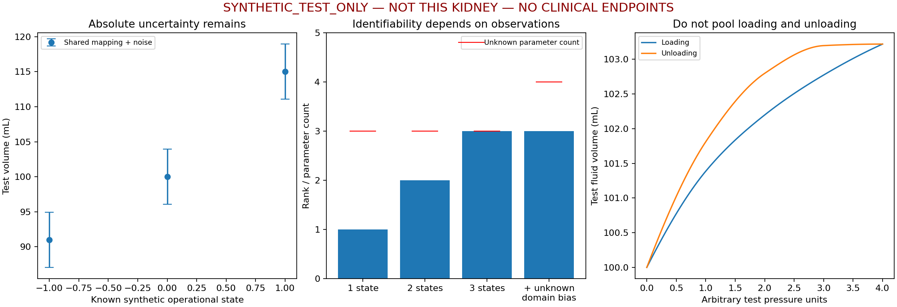

# Capacity V2 N1.5-M：医学证据与容量端点标定研究

版本：2026-10-15-v1。**本阶段研究已交付，等待用户与医学研究人员评审；未设置实际端点，未实施 N2。**

## 1. 结论与当前真实参数

本轮取得的证据**不能直接确定本例正常最小／最大容量，也不能给出有数据支持的患者特异数值区间**。这不是“文献完全没有容量研究”：已有静态测容、成对影像、离体顺应性和术中压力研究，但没有同时满足本例测量域、个体、状态、边界条件及端点覆盖的资料。

正式 D2 仍为 `C11_R1_IN02_fixed_collar`，项目几何参考容量仍为 **16.805962087430178 mL**。这是原已批准边界的测量值，不是人群百分位、生理中点或本轮重新标定的绝对生理容量。此次只读取批准记录与来源哈希，没有重新移动截面、扣除过渡根部或计算两个嵌套环的外减内面积。

新状态记录为 [real_parameter_status.json](../godot_sim/deformation/capacity_v2_n15_m_v1/real_parameter_status.json)：

```json
{"V_min_mL": null, "V_max_mL": null, "pressure": null,
 "compliance": null, "real_flow_mL_s": null, "patient_interval": null}
```

**优先路线：先审核现成、合法可用的同一个体多状态三维影像及其采集记录。** 若没有可用资料，继续保持 null；可以推进全文／数据可用性研究及方法验证，不能改走任意容量百分比扫描。群体路线用于条件参考与个体预测研究，压力—流量路线用于已记录边界条件下的联合标定，两者均不能凭现有摘要替本例赋值。

## 2. 检索、去重与阅读范围

检索日期 **2026-10-15**。数据库主线为 PubMed（含 MEDLINE 与尚未完成 MEDLINE 索引的记录），NCBI E-utilities 保存实际查询及响应；另核对期刊原文、公开作者稿、Crossref 元数据和 EAU 原站。未声称独立检索了全部 MEDLINE 平台、Embase、Cochrane 或付费数据库。

四条主检索覆盖 1800-01-01 至 2026-10-15，未设语言限制：

| ID | Title/Abstract 概念组合 | 实际返回 |
| --- | --- | ---: |
| PM1 | renal pelvis / pelvicalyceal / pyelocaliceal × volume / volumetry / capacity × normal / healthy | 66 |
| PM2 | renal pelvis / collecting system × hydration / diuresis × ultrasound / MRI / volume | 48 |
| PM3 | renal pelvis / collecting system × pressure-volume / compliance / distensibility | 56 |
| PM4 | ureteroscopy × intrarenal / intrapelvic pressure × prospective / consensus / review | 61 |

主检索 **231 条命中，按 PMID 去重为 220 条，11 次重复命中**，没有 retmax 截断。精确可执行检索式、NCBI 自动翻译和每次返回的 PMID 见 [pubmed_search_log.json](../godot_sim/deformation/capacity_v2_n15_m_v1/literature/pubmed_search_log.json)。

补充同义词及旧种子文献核对、Mann/Morse 引用追踪新增 14 个 PMID；再沿 Nakagawa 的参考文献追踪 Will 2014，并核对新发现的 Ghoul 2026，新增 2 个 PMID。总计 **236 个唯一 PubMed 记录：232 篇期刊记录及4个书籍章节**。原四条查询统计没有被后续追踪覆盖。Mann 1990 在 PubMed 指定检索中无命中，其被引 DOI 的 Crossref 请求为404；只保留引用线索，未把二手样本数字当成已核实事实。

纳入重点：健康成人状态变化／集合系统测容原始研究；能解释容量—压力及出口条件的原始实验和模型；界定 URS 适用范围的共识／综述／指南。儿童、动物、梗阻和离体研究作为**分开管理的适用性对照**，不混入健康成人样本。排除直接标定的情形包括：仅全肾实质体积、尿液排出量、饮水量、肾积水分级、没有测量域／状态对应的压力值等。

这是有保存检索式、来源、提取表和限制的**结构化证据复核**，不是宣称穷尽文献的双人系统综述或 Meta 分析。对全部返回标题做聚焦分流，28项进入逐字段矩阵；其余记录的 `NOT_SELECTED_IN_FOCUSED_TITLE_TRIAGE` 不等于已阅读全文后判定无效。书籍章节单列排除。没有虚构双人独立筛选或全文排除原因。日志见 [screening_log.json](../godot_sim/deformation/capacity_v2_n15_m_v1/literature/screening_log.json)。标题摘要检索可能漏掉未使用这些术语的影像方法文献；Will 2014 正是通过引用追踪补入，后续需继续沿原始方法文献补查。

28项阅读情况：**5项全文主要正文读完；2项已取得全文、阅读相关方法／结果／附录；19项仅摘要；1项仅引用；1项指南相关章节**。全文取得与阅读范围分开记录，附表未取得就明确写未取得；不从缩略图估算数据。版权全文仅作本地忽略缓存，不作为可再分发原始数据提交。公开可读不等于有患者级数据或可自由再分发。

## 3. 证据矩阵与本轮新增发现

完整逐字段表含题目、全部元数据作者、DOI、样本、人群、部位、截止、方法、状态、单位、分布、成对变化、流量／初始容量／漏液／滞后、误差、定位与访问状态：

- [可读证据索引](../godot_sim/deformation/capacity_v2_n15_m_v1/evidence_matrix.md)
- [逐字段证据矩阵](../godot_sim/deformation/capacity_v2_n15_m_v1/evidence_matrix.json)

E等级针对**当前 D2 生理端点的适用性**，不表示论文的总体质量：E1潜在同域直接标定；E2需补足域映射／条件／数据；E3机制与范围；E4本例端点不适用。结果为 **E1=0、E2=5、E3=14、E4=9**。没有一项当前可直接用于本例端点拟合。

| 研究组 | 复核发现及本例用途 |
| --- | --- |
| M01 Leuschke 2026 | 人体离体／尸体研究，封闭 UPJ 灌注，初始容量、重复加载和内部漏液有重要影响；可参考联合标定的结构，不能作为活体正常端点。论文归一化、样本筛选和终止压力都不是本项目安全阈值。[原文](https://e-century.us/files/ajceu/14/2/ajceu0170543.pdf) |
| M02 Rousan 2025；M11/M12 Morin/Morse | 健康志愿者的状态相关超声变化支持记录补液、排尿及时间；分级／径线不提供同域三维容量。Rousan 摘要与正文显著性阈值、百分比／分母及“膀胱体积”标签存在待澄清差异，不合并比例或推算容量。Morse 原摘要的“至少一次”不能改写为每个时点发生率。[Rousan 原文](https://pmc.ncbi.nlm.nih.gov/articles/PMC12381993/)、[Morse 原摘要](https://pubmed.ncbi.nlm.nih.gov/10424912/) |
| M03 Zheng 2022 | 健康供者左肾与肾积水患者分开；sRCPV 是肾盂肾盏量，不是肾实质 sRPV 或分肾功能。未取得健康组完整容量分布与截止定义，不能使用混合样本均值。[原摘要](https://pubmed.ncbi.nlm.nih.gov/35764436/) |
| M08 Sung 2020 | 成对 CT 三维集合系统测容有方法价值，但为结石患者且完整个体配对表未取得；报告的群体体积变化绝不能直接乘到 D2 上。[原摘要](https://pubmed.ncbi.nlm.nih.gov/31984761/) |
| M09 Nakagawa 2025；M27 Will 2014 | 前者比较姿势且单列肾盂，但摘要没有肾盂数值结果；后者验证 MR 肾盂分割误差，而非给出生理端点。均需全文边界、状态和原始掩码；不能用全肾结果替代腔体。[Nakagawa](https://link.springer.com/article/10.1007/s12194-025-00952-9)、[Will](https://link.springer.com/article/10.1007/s10334-014-0429-4) |
| M13 Acar 2006 | 有健康对照静态 IVP 公式估算体积；不是现代三维测容，也不是同一个体动态范围。双肾不是独立受试者，不用其均值／SD生成本例百分位或换算系数。[原摘要](https://pubmed.ncbi.nlm.nih.gov/16750255/) |
| M04/M07 Croghan 2023/2024 | 术中／置管条件下压力资料；“灌注前基线”仍可能已有导丝等器械，不能称未置械健康正常状态。无同步同域容量，不能从压力反推出本例端点；两论文样本独立性未核实，不合并。[2023原文DOI](https://doi.org/10.1111/bju.16169)、[2024原摘要](https://pubmed.ncbi.nlm.nih.gov/39107937/) |
| M05 Oratis 2018；M06 Williams 2020 | 前者常顺应性假设、后者非线性模型及猪肾加载历史说明模型形式并非已统一标定。原始供体系数不迁移；Williams作者稿附录有误差与滞后讨论，不能抹去加载／卸载差异。[Oratis](https://journals.plos.org/plosone/article?id=10.1371/journal.pone.0208209)、[Williams作者稿](https://people.maths.ox.ac.uk/moulton/Papers/FullSystemPaperFinal.pdf) |
| M10 Wolf 2024 | sinus分割包含脂肪、集合系统及慢流血管；其 ROI 体素数不是孤立腔体容量，剪切储能模量不是 dV/dP。[原文方法](https://www.frontiersin.org/journals/physiology/articles/10.3389/fphys.2024.1327407/full) |
| M14～M20 | 成人结石对侧、儿童肾积水／梗阻、猪／兔实验分别保存，不能当健康成人动态端点。尤其 M20 虽题目写 in-vivo，实际是猪模型。详细原文摘要链接见矩阵。 |
| M21～M25、M28 | 共识／综述／EAU用于界定术中压力风险和方法异质性，不提供容量端点。全肾 MRI 人群体积及2026新分割算法并非腔内体积。Delphi未取得统一临界压力共识；EAU的临床压力讨论也不自动成为本模型安全边界。[Delphi](https://pmc.ncbi.nlm.nih.gov/articles/PMC11815979/)、[EAU](https://uroweb.org/guidelines/urolithiasis/chapter/guidelines)、[Ghoul原始研究](https://pmc.ncbi.nlm.nih.gov/articles/PMC13049282/) |

每项数值的原文摘要／页码／表号在矩阵的 `numeric_claims` 与 `locator`，未取得的数据为 null；未数字化论文曲线，也没有用摘要补齐个体数据。本轮不对旧证据报告作回写；更严格的可用性限制只记在本版本。

## 4. 正常与操作性端点

**不存在由当前证据证明的“所有健康成年人通用绝对最小／最大容量”。** 健康未置械状态 A 与内镜灌注状态 B 的测量边界和动力学应分别管理。

| 条件 | 可研究的端点定义 | 必须补足的证据 |
| --- | --- | --- |
| A1 未置械、无已知梗阻 | 医学人员预先定义的两个生理状态／时间窗下，个体容量代表值及不确定性 | 同个体同域三维影像；明确补液／尿液产生／排尿／膀胱／姿势／采集时相；时间窗覆盖与重复性 |
| A2 正常状态包络 | 预定义生理条件集合内的条件区间或指定分位，而非无限时域绝对极值 | 密集且可追溯的状态采样、代表性和周期／读数误差区分；不能只取两张影像的极值 |
| B1 指定内镜配置的受控状态 | 在医学认可的指定器械／出口／灌注条件及观察时间下的低、高操作状态容量 | 相同器械占位、通路、压力测点／零点、同步流入流出／漏液及绝对初始容量；或条件匹配影像 |
| B2 加载与卸载状态 | 若有滞后，则分支、速率、历史与等待条件分别规定 | 既有合法数据中覆盖两个历史分支；不拿实验终止或组织损伤点充当“正常最大” |

这些是**供医学与用户选择的定义框架**，本轮未选择饮水量、利尿药、灌注压力、实验加载上限或患者操作条件。病理性肾积水、输尿管阻塞、离体封闭灌注的终止点与临床安全阈值均不是 A 的端点；A 的结果也不能不经验证迁移到 B。

## 5. D2 域映射与三条标定路线

详细公式、误差、可识别性、输入结构和门禁见 [标定设计](kidney_irrigation_capacity_v2_n15_m_calibration_design.md)。映射结论是：当前源面与封口能追溯**工程 D2**，没有临床影像对照就不能识别文献肾盂／UPJ范围与 D2 的容量差。保留的 B_31/B_32 根部不能凭编号减掉，人工残余也不能假定为状态不变的常数。

| 路线 | 优先性与可交付推断 | 当前阻塞 |
| --- | --- | --- |
| A 同个体多状态三维影像 | **优先**；在条件、边界与误差审核后得到个体操作性区间 | 无实际配对影像／分割／采集状态，Reference生理状态未知 |
| B 健康成人群体 | 次级；同域同条件的群体区间、将来可审查的个体预测 | 全文／原始分布不足，静态分布不能识别个体动态端点；域及协变量未知 |
| C 压力—容量与流量 | 针对B或明确实验条件的补充；联合守恒与历史分析 | 无初始绝对容量、同步Qin/Qout/Qleak/P、设备与出口记录；只有压力无法估计顺应性 |

两端状态都经过直接测量、同域校正且条件覆盖充分，才可能分别估计两端；重复测量和独立误差评价仍不可省。若还要拟合非线性函数，中间独立状态与加载／卸载观测要求取决于模型自由度，不能宣称“两张片子就标定全部动力学”。没有同域资料时既不能给患者置信区间，也不能凭强先验制造看似精确的后验端点。

## 6. 数据审计与下一步资料

[工作区审计](../godot_sim/deformation/capacity_v2_n15_m_v1/project_data_inventory.json)未找到实际 DICOM/NIfTI/NRRD 或分割体素文件，也未取得配对影像／压力流量资料。README 第10、45行记载被忽略的原 CT 目录，但该目录当前不存在；这是**现有资料线索**，不是已获得的扫描。目录名字不能证明扫描日期、时相、患者性别或采集条件。没有搜索无关磁盘或提取身份信息。

已知仅为用户说明：成人，无结石梗阻或肾积水；CT 是否排泄期未知，无前后影像／压力—容量实测。这不是新的临床诊断。mm尺度继续沿用已验收工程，没有 DICOM 独立标定。细化的数据需求、已有状态、缺失影响和替代局限见 [合作资料清单](kidney_irrigation_capacity_v2_n15_m_data_requirements.md)。本轮不要求立即新增医学检查，不发送联系作者的邮件，不制定人体灌注实验。

## 7. 实际方法验证与保护

新增原型仅处理明确标记的 **SYNTHETIC_TEST_ONLY**：一个与本例无关的合成方法夹具，验证单位、非对称端点、秩亏、域偏差、流量守恒、初始容量缺失、漏液缺失、占位及滞后分支。没有实际论文患者数据拟合，也没有五组容量百分比候选扫描。

- 单 Reference 的三参数示例设计矩阵秩1、零空间维2；三个已知状态可满秩，但增加未知公共域偏差又产生不可识别方向。
- 公共域偏差不会随重复分割次数增加而消失；只有它确实状态不变时才会在成对差分中抵消。
- 缺少 Vinitial 时输出绝对容量 null；缺少漏液等守恒分量时连净滞留变化也标未识别。
- 合成输入不能进入真实拟合／审批；输出路径限定在新版本 `synthetic/`，没有写入真实运行端点的接口。

已运行 **32项自动测试，全部通过**，见 [tests.json](../godot_sim/deformation/capacity_v2_n15_m_v1/tests.json)。受保护 **2487个旧文件 SHA-256 全部一致**，涵盖旧记录／几何／运行资源及版本控制内文件；既有组织、腔体、D2及 P2 输入未变。额外按正式记录核对六份P2运行数组及其源数组、D2九份冻结文件，均匹配。源访问、提取与工具的哈希见新版本清单。9项核心数据／图像重复构建逐字节一致。方法图已实际渲染并检查，图上明确标记合成数据；不是 Godot新形态截图。

全部新证据、模板、合成结果、来源与哈希位于 `godot_sim/deformation/capacity_v2_n15_m_v1/`。本轮5个新工具／测试和3份新设计报告同时以字节一致审核快照保存于该版本的 `implementation_snapshot/`；快照用于追溯，运行采用下列仓库正式路径。既有历史文件没有回写。



旧 P2.3 约18～19 FPS限制仍未解决，本轮没有修改显示实现、控制器、场景或法线。旧点／边接触与共面重叠仍为工程基线，不扩大为连续区间安全证明。

## 8. 可重复执行与阶段衔接

在仓库根目录执行（依赖 Python、NumPy、SciPy、Matplotlib；已在项目 FURS 环境运行）：

```powershell
& 'E:/Apps/Conda/miniconda3/envs/FURS/python.exe' -X utf8 godot_sim/tools/capacity_v2/build_n15m_evidence.py
& 'E:/Apps/Conda/miniconda3/envs/FURS/python.exe' -X utf8 godot_sim/tools/capacity_v2/n15m_calibration.py
& 'E:/Apps/Conda/miniconda3/envs/FURS/python.exe' -X utf8 godot_sim/tools/capacity_v2/test_n15m.py
& 'E:/Apps/Conda/miniconda3/envs/FURS/python.exe' -X utf8 godot_sim/tools/capacity_v2/finalize_n15m.py --repeat
```

离线重建使用已保存书目响应，不依赖忽略的版权全文缓存。若需更新公开检索，可分别运行 `n15m_sources.py --pubmed`、`--supplement`、`--citations`、`--fulltexts`，但应新建后续版本保存新日期／响应，不能把当前固定日期脚本当未来实时检索日期。网络权限及原站可用性会影响更新，失败保留日志；读取或下载成功不自动改成“已读全文”。

后续建议依次为：①医学人员与用户定义A或B的操作性端点；②审核现成资料与使用权限；③补足E2全文／数据及D2映射；④单独批准真实标定并评价区间与覆盖；⑤用户／医学共同批准带来源和不确定性的端点；⑥再单独授权N2。

若证据显示 Reference 不在所定义两端之间，必须重审状态定义，不能强制拟合或移动已批准D2。标定通过后仍需独立求解两侧形态、D2实际积分、组织协调及连续几何门禁；视频保持“外部整体变化→内镜视角→合格路径”，器械包络与净空需另验。**本阶段完成后停止，等待医学证据与标定设计审核。**
