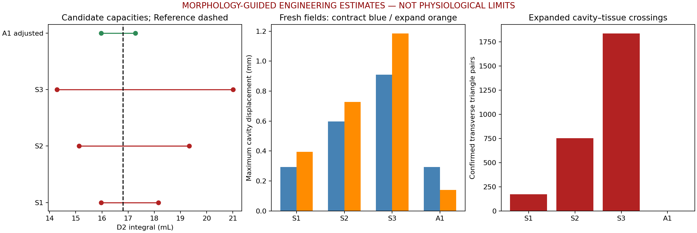

# Capacity V2 N1.6：几何约束下的双向工程容量估计

日期／版本：2026-10-15-v1。标签：**MORPHOLOGY_GUIDED_UNCALIBRATED_CAPACITY_ESTIMATE**。

**建议选择调整方案 A1：15.965664～17.276823 mL，Reference仍为16.805962087430178 mL。** 收缩约−5%，扩张约+2.80175%，分别计算。它是当前形态响应与暂定组织映射下通过已执行预检查的工程候选，**等待用户选择，不是已验收N2，不是健康成年人正常生理容量上下限**。

本次路线调整已独立记录在新目录 `authorization.json`。不再以取得患者多状态影像／临床标定为工程形变设计前提；同时保留N1.5-M“患者特异生理端点不可识别”的历史结论与全部null参数。

## 1. 三组候选与调整建议

以下容量由临时全网格偏移、批准D2源顶点重心映射及**实际有向三角面积分**得到，没有将N1候选分区体积按比例缩放。表中位移为真实mm，不是展示放大值。

| 方案 | 收缩侧D2积分 mL | 扩张侧D2积分 mL | 相对Reference | 腔体最大位移：缩／胀 mm | P95位移：缩／胀 mm | 本原型结论 |
| --- | ---: | ---: | --- | --- | --- | --- |
| S1 | 15.965664 | 18.150439 | −5%／+8% | 0.293562／0.395498 | 0.220425／0.304802 | 收缩预检查通过；扩张新增173对腔体—组织真实穿越，整组不推荐 |
| S2（优先评估） | 15.125366 | 19.326856 | −10%／+15% | 0.596537／0.728318 | 0.447917／0.561301 | 收缩接近面积门槛；扩张新增753对穿越，不硬选S2 |
| S3 | 14.285068 | 21.007453 | −15%／+25% | 0.909864／1.184772 | 0.683182／0.913082 | 面积／梯度和接触均失败，当前原型拒绝 |
| **A1调整** | **15.965664** | **17.276823** | **−5%／+2.80175%** | **0.293562／0.140463** | **0.220425／0.108252** | 已执行预检查通过；仍需用户选定和正式N2验证 |

S3的数值只是当前材料映射封口下的**有向积分目标**：出现测量封口相交后，不能把它直接当成有效无重叠封闭空间容量。所有失败保留，不因为积分达到数值就宣称可行。S1/S2/S3失败只说明**当前响应／暂定组织映射不能实现合格形态**，不是证明所有可能的局部联合求解都无法实现这些容量。

完整可读数值为 [comparison.json](../godot_sim/deformation/capacity_v2_n16_v1/comparison.json)；待选择配置为 [engineering_capacity_estimate.json](../godot_sim/deformation/capacity_v2_n16_v1/engineering_capacity_estimate.json)。其中 `runtime_eligible=false`、`N2_authorized=false`，没有改写任何P2输入。



## 2. 新响应的来源与独立性

腔体响应**从Reference重新计算**，未将旧0.2mm腔体场或P1.5组织场放大、取负、重命名。旧场仅在自动测试中作“不是比例复制”的对照。没有统一2mm上限，也没有全模型等比例缩放。

复用原37路径、源面/顶点编号、P1.2权重及其固定区；天然MAIN/B01～B30全部参与。方向候选只在同一路径及共享真实端点的拓扑邻域内混合，并受表面连通距离与轴向支持限制，不让全部天然路径参与每个顶点，也不因欧氏距离近而跨不相连分支混合。后续平滑沿真实网格边传播。

N1的 `PATH_LOCAL_SECTION` 可信局部站点提供等效半径和等效短轴尺度。同路径站点之间插值；离可信站点较远或没有独占截面时，改用**自身中心路径—壁面几何**的保守尺度，并降低响应置信权重，不使用最大环／外环面积回退。两处未解净面积仍保持未确定，B27:25/B30:4邻近另有保守响应衰减，未重算外减内、未重开D2边界。

两方向的工程响应规则不同：扩张对窄区保留较温和响应；收缩在短轴较小区域施加更强抑制。中心路径径向与壁面法线融合，末端增加法线贡献，J区通过同一连续表面解共享位移，B31/B32由原P1.2权重过渡到固定管壁。阈值、权重和正则参数均为**工程假设**，不是材料顺应性或医学常数。源站点ID、局部半径、支持范围与参数在 `response_design.json` / `local_radius_mm.npy` / `local_confidence.npy`。

第一轮全部候选在B26源面535 `[415,441,442]` 的细长三角形触发面积门禁：S1缩侧最小面积比0.676636、胀侧最大1.503281。定位后只作**一次**形状保护试验：对原参考质量<0.2且最小高度<0.25mm的1537个细长面，惩罚对边插值之外的相对位移，强度0.05mm²／高度²。解保持 `D=原批准权重×H`，3675固定顶点严格消元为零，没有增加全局Laplacian强度、改变网格或冻结整个接口区域。初始失败数据和修正结果分开保留；修正参数没有按候选反复搜索。

组织是**独立新建的暂定跟随场**：Reference最近三角面重心几何目标、法线／侧向和拓扑相容筛查、表面连通衰减、短边度量正则。保留139真实共点严格一致性及远场零位移；原参考已确认共面接触面提供暂定接触约束，其余近壁点软约束，F03/F04保持低置信而不伪造归属。没有复制旧组织场，也没有反向改动任何已验收腔体数据。这个暂定映射在较大扩张下失败，正是本轮缩小推荐范围的主要依据。

## 3. 容量—位移敏感性与区域贡献

令新单位响应为 `D_-`／`D_+`，幅度q≥0。原D2源映射为W：

`v_D2(q)=v_D2,Reference + q W D_direction`。

采用同一材料映射三角化时，真实积分为三次多项式，而非线性容量：

```text
收缩 V(q) ≈ 16.805962087430167 − 10.964760816522762 q
             + 2.1274587261117794 q² − 0.023177336660633766 q³
扩张 V(q) ≈ 16.805962087430167 + 12.651752317758493 q
             + 2.675824903726415 q² + 0.03568172328580359 q³
单位：V为mL，q为该工程单位响应的无量纲幅度。
```

每个目标用数值求根后再直接积分复核。Reference处敏感性约−10.965／+12.652 mL每单位q，**不是dV/dP**。A1缩侧q≈0.077810、胀侧q≈0.036928；两侧不是相同位移取反。

容量变化归属采用互斥源顶点响应支持：MAIN/B、J共享区、T端帽和过渡区各顶点只有一个账目标签，将D2体积梯度沿实际轨迹积分，计算 `∫ grad(V_D2)·D_region dt`。三点Simpson对该二次导数项精确，贡献之和与实际D2容量变化残差<10⁻⁹mL。包含虚拟测量封口的映射贡献，分叉不重复计量。

这是**本次形变机制的容量增量归因**，不是N1候选解剖分区晋升、不是各分支原始容量。A1缩侧总变化−0.840298mL，MAIN支持约贡献−0.201502mL（约24%）；宽区和其他分支共同承担余量，不能把MAIN直接称临床全部肾盂。B10/B25/B28/B30等也有明显贡献，J共享区、末端和过渡空间单列。各候选的完整 `capacity_contribution.regions` 保存于其 `preassessment.json`，没有使用重叠截面积积分相加。

## 4. 工程质量与接触结果

物理腔壁／组织门禁不变：边位移梯度≤0.2，面积比0.8～1.35，无退化／相对Reference法线翻转。执行五档0、0.25、0.5、0.75、1的几何检查；对线性顶点轨迹进一步求四次面积平方函数的全部区间极值，并解析检查有向面积最小值，覆盖整个两侧轨迹的面积与方向。

| 临时状态 | 腔体全过程面积比 | 腔体最大梯度 | 组织全过程面积比 | 组织最大梯度 | 终态腔体—组织确认穿越对 |
| --- | --- | ---: | --- | ---: | ---: |
| S1缩 | 0.902491～1.041223 | 0.071065 | 0.907204～1.021959 | 0.057334 | 0 |
| S1胀 | 0.936075～1.144055 | 0.102872 | 0.969635～1.123301 | 0.081180 | 173 |
| S2缩 | 0.806530～1.083251 | 0.144408 | 0.811377～1.043345 | 0.116506 | 0 |
| S2胀 | 0.880867～1.275139 | 0.189440 | 0.941321～1.226799 | 0.149496 | 753 |
| S3缩 | **0.706036**～1.125933 | **0.220258** | **0.712260**～1.064969 | 0.177700 | 12 |
| S3胀 | 0.801084～**1.468713** | **0.308167** | 0.898406～**1.368332** | **0.243188** | 1838 |
| A1胀 | 0.977374～1.049654 | 0.036535 | 0.989518～1.043829 | 0.028832 | 0 |

所有物理候选有限、未出现退化／相对原法线翻转，但这不能抵消面积／梯度或相交失败。S2缩侧虽通过物理指标，最小面积距0.8门槛很近，暂定映射／测量封口的余量不足，不用它扩大推荐收缩幅度。

有限几何检测保持 **1e-10mm** 判据、零broad-phase容差。双平面跨越只作候选，再验证有限相交段确在两个三角形内；共面多边形重叠另算。没有使用已被更正的“58对无限平面候选就是真穿越”，也没有把原组织23对候选直接称真自交。新自交broad-phase采用静态空间索引穷举相交包围盒，物理自交按原规则排除共享源顶点的相邻面；与有限判据分离。原参考候选复用已有缓存，避免重复大规模参考计算。

实际覆盖：

- 腔体自身、材料映射D2自身、腔体—组织：Reference及四个非零采样档均检查。
- 组织自身：Reference缓存复核及每个候选终态全网格检查；**中间三档组织自身相交尚未全量扫描**，不能写成完整五档自交通过。
- 全过程面积、面方向、固定点：解析／代数检查；**没有全过程连续碰撞证明**。

源腔体B24既有 `[1856,1862]` 候选及组织原始候选保留，本次有限判据在Reference均未确认横向穿越。A1两侧已扫描的腔体／组织自交与相互穿越没有新增确认问题。原42对腔体—组织共面重叠配对保留；配对面积之和从12.073980mm²变为缩侧11.709248、胀侧12.260087mm²。该面积和可能重复计量，**不是穿透面积**，其保留也不证明生理可接受；点／边／近接触候选与横向穿越分开，未分类的broad-phase候选不冒充真实接触。

3675个固定腔体顶点、139真实共点及组织远区零位移全部逐值检查。F01/F02两环邻域未再次触发门禁；F03/F04解剖归属仍未确认。

## 5. 为什么扩张推荐约+2.80%

S2扩张四档确认穿越为18／153／317／753对；S1扩张为0／20／39／173对。首次已检测到的异常主要在 **B30邻近组织**，例如腔面1353／组织面90282，位置约 `[2.242887,6.437904,-48.378454] mm`。这是真有限几何相交，不能靠“面积正常”忽略。终态后续扩散至其他分支，分组源面、位置和相交段长度见 [crossing_clusters.json](../godot_sim/deformation/capacity_v2_n16_v1/crossing_clusters.json)。相交段长度不是穿透深度。

保持两套新响应及全部阈值不变，在已观察的无穿越／有穿越区间只细化一个幅度变量，6次二分得到：已知无横向穿越采样约 **17.395680mL（+3.50898%）**，已知失败采样约 **17.400089mL（+3.53522%）**。这只是当前暂定映射的一处采样转变区间，不是全局首次接触的连续证明，更不是几何／医学绝对容量上限。

选取无穿越边界幅度的0.8倍作为**工程余量假设**，再对实际D2积分，得到 **17.27682308021336mL**；不是把容量变化率直接乘0.8，也不是新的医学比例。A1胀侧随后重新执行五档物理质量、采样接触及终态组织自身检查，均通过已执行门禁。缩侧保留余量更大的S1（15.96566398305867mL），不强制两侧对称。

## 6. 虚拟封口、间隙与内镜风险

D2材料映射会让BLADDER等测量截环稍有非平面变化；原封口中的细长三角面可能出现很大的面积比／相对原法向转角。它们是**测量闭合面，不是物理腔壁或组织**：面积比例仍完整输出，不能与组织材料门禁混为一谈；闭合、绕序、非退化与有限相交门禁仍然保留。

本次另在同一材料边界环上，用三种起耳顺序进行非重叠投影耳切封口敏感性检查。没有质心扇形封口，没有移动R1截面／恢复C06／删天然壁；真实D2源壁与边界重心映射保持一致，派生封口只存N1.6诊断JSON，不进入显示或碰撞网格。保留每个候选环、面编号与失败记录，均可重建。

A1两侧四个非零采样档三种替代封口均闭合、绕序一致、非退化，未确认封口—壁面或封口自身相交；终态容量试验范围约：

- 缩侧：15.965568～15.965664mL，三种有效封口差约0.000096mL。
- 胀侧：17.276823～17.276866mL，差约0.000043mL。

这只是三种有效封口的敏感性，不是所有可能封口的严格界，更不是临床误差或置信区间。S2缩侧0.75的一种替代封口确有3对封口—壁面穿越，已拒绝该变体；没有因其他变体有效而抹去失败。S3材料映射D2出现新增自身穿越（缩侧终态2对／胀侧1对），其原积分不能升级为可靠空间容量。正式N2必须明确移动边界与连续封口策略，并重新求根，不直接导入本轮封口或字段。

窄区额外采样参考中心路径到实际三角壁面的距离，作为**静态中心路径探针**：A1缩侧最小样本约B07 0.329951mm，胀侧约0.376118mm；缩侧MAIN最小样本较Reference减少约0.167982mm。已采样可信局部站点没有出现正距离符号提示的域外点。它不是真实截面短半轴，不是器械净空或壁厚；未解多环站点未纳入。尚未选择视频内镜路径、器械包络、弯曲/相机姿态及展示状态，**不能凭这些探针认定能通镜**。

J05/J09及短接口的局部源面指标均保存。A1缩侧J05/J09/B31/B32最大梯度约0.0181/0.0682/0.0511/0.0490；胀侧约0.0099/0.0365/0.0333/0.0267，未扩大固定区或重新计算掩码。

视觉预期仅为几何推断，尚未新建Godot预览或用户验收：A1变化温和，缩侧局部轮廓变化较胀侧明显；S2/S3变化更大但当前失败。未来可用同视角参考线、位移热图／剖切强调微小变化，不能擅自放大真实位移。

## 7. 证据等级、交付与验证

本轮定义工程证据等级：G0解析／设计；G1临时全网格实际积分及面积／梯度验证；G2在G1上增加采样有限几何检测；G3正式N2/N3全流程及运行时／人工验收。它与N1.5-M医学E等级无关。A1达到**带限制的G2预评估**，没有G3或临床标定资格。

新数据均在 [capacity_v2_n16_v1](../godot_sim/deformation/capacity_v2_n16_v1/)：目标清单、独立单位响应、初始失败原型、细长面修正原型、调整候选、逐态质量／接触、源面分组、封口／局部／距离指标、配置、图、测试和哈希。`.npy`均以 `research_` 命名；大体积逐面对检查JSON无损压缩为`.json.gz`，原JSON只是可重建本地缓存，数值不截断。读取工具支持两种格式。

已执行 **21项自动测试**：目标实际积分、非线性容量、区域守恒、源映射与哈希、3675固定点、139共点／远场零位移、不是旧场比例复制、两方向独立、未解净面积不使用、有限相交误报复核、失败候选不得晋升、A1采样门禁及Reference恢复等。N0/N1/P1/P2/N1.5-M、原OBJ、Marker、D2、main及内镜／碰撞相关 **2486个既有文件哈希保持不变**。重复构建与归档／源码清单见新目录 `repeat_build.json` / `delivery_manifest.json`。

本轮未进行Godot图形运行、FPS测试、动态碰撞、路径运动或录像；旧P2.3约18～19FPS限制仍保留。临时数值原型检查不能替代float32显示及连续运行验证。

## 8. 重建命令与停止

在仓库根目录，使用项目Python环境（NumPy/SciPy/Open3D/VTK/trimesh/Matplotlib）：

```powershell
# 可选：复现首次未加细长面保护的失败试验，输出 attempts/initial 和 prototypes/initial
& 'E:/Apps/Conda/miniconda3/envs/FURS/python.exe' -X utf8 godot_sim/tools/capacity_v2/n16_feasibility.py
# 当前修正原型
& 'E:/Apps/Conda/miniconda3/envs/FURS/python.exe' -X utf8 godot_sim/tools/capacity_v2/n16_feasibility.py --corrected
& 'E:/Apps/Conda/miniconda3/envs/FURS/python.exe' -X utf8 godot_sim/tools/capacity_v2/n16_contacts.py
& 'E:/Apps/Conda/miniconda3/envs/FURS/python.exe' -X utf8 godot_sim/tools/capacity_v2/n16_closure_and_regions.py
# 接触边界细化与唯一调整备选
& 'E:/Apps/Conda/miniconda3/envs/FURS/python.exe' -X utf8 godot_sim/tools/capacity_v2/n16_adjusted_candidate.py
& 'E:/Apps/Conda/miniconda3/envs/FURS/python.exe' -X utf8 godot_sim/tools/capacity_v2/n16_contacts.py A1_expand_contact_margin
& 'E:/Apps/Conda/miniconda3/envs/FURS/python.exe' -X utf8 godot_sim/tools/capacity_v2/n16_closure_and_regions.py A1_expand_contact_margin
& 'E:/Apps/Conda/miniconda3/envs/FURS/python.exe' -X utf8 godot_sim/tools/capacity_v2/n16_report.py
& 'E:/Apps/Conda/miniconda3/envs/FURS/python.exe' -X utf8 godot_sim/tools/capacity_v2/test_n16.py
& 'E:/Apps/Conda/miniconda3/envs/FURS/python.exe' -X utf8 godot_sim/tools/capacity_v2/n16_finalize.py --repeat
```

接触扫描缓存必须匹配两个临时偏移SHA-256，否则报错，不能用旧缓存给新几何放行。首次全部扫描较慢；重复构建复用已核实缓存。最初CSV编码拼写错误已修复；首次不适合大组织的全量自交调用已停止，替换为空间索引候选加同一有限判据，未修改P2运行性能路径。

下一步正式计划见 [N2求解计划](kidney_irrigation_capacity_v2_n16_n2_plan.md)。**本轮到此停止，等待用户选定工程容量范围。A1配置只是建议；不自动晋升任何研究偏移、不修改P2、不启动N2或录像。**
