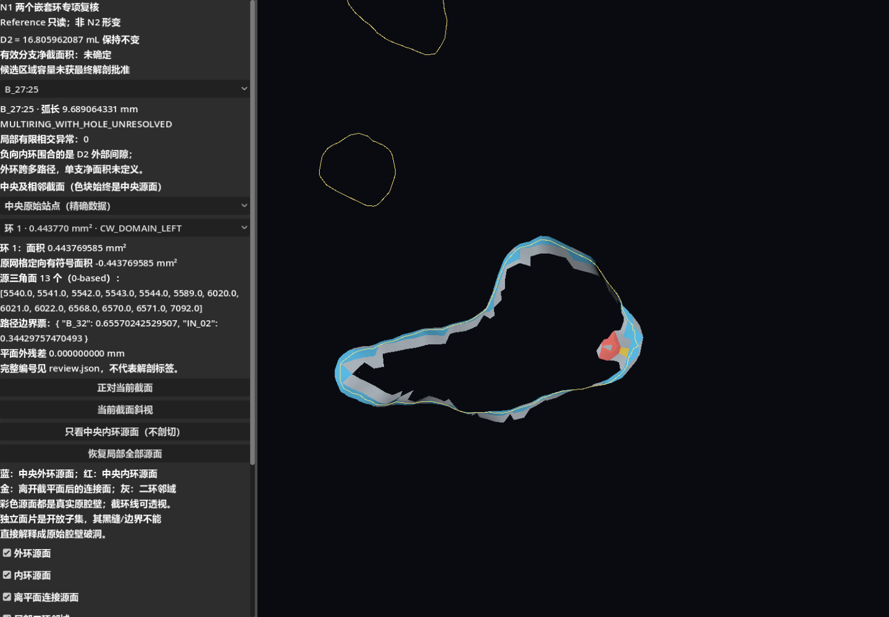
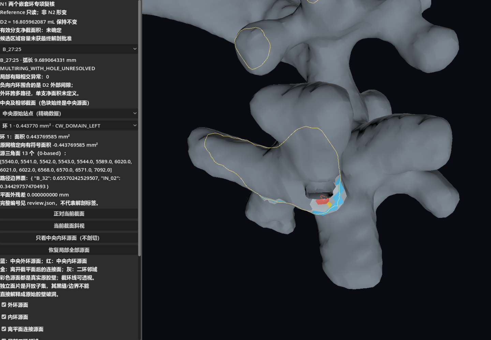
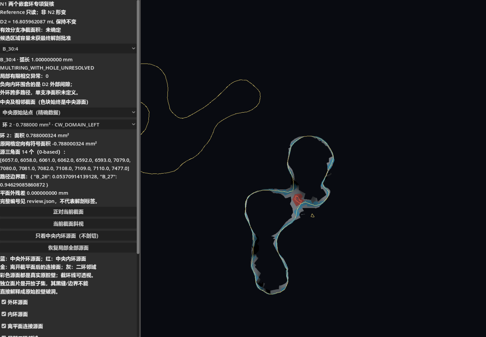
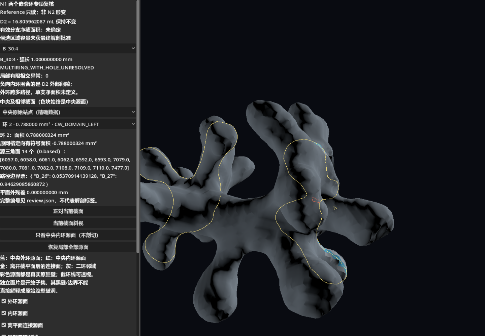

# N1 人工反馈与两个嵌套环专项复核

日期：2026-10-15。**N1工程工具和已有数据的人工验收已独立记录；两个目标分支的净截面积仍未确定，不进行外环减内环。**

## 1. 人工反馈及只读范围

新增 [human_review_2026_10_15_v1.json](../godot_sim/deformation/capacity_v2_n1_nested_review_v1/human_review_2026_10_15_v1.json)：用户认可J_05/J_09/B_31/B_32显示与局部结构，确认两个嵌套轮廓已准确定位，未发现足以确认真实腔壁穿透的新证据。仅认可N1工程交付，不批准两个外环作为有效净面积，也不批准候选容量为最终解剖分区。旧N1/N0报告和数据未回写。

D2总参考容量保持 **16.805962087430 mL**。本轮只读原始D2、P1/P2输入和两个站点，另存局部源面显示派生物；未重新划分全肾、未设端点、未生成N2形变。

## 2. 方法与判定边界

读取原N1完整精确闭环与源面映射，而不是从预览简化线提取。以原网格外向三角面法线和截面法向决定真实截环方向：切向为`plane_normal × outward_face_normal`，在右手平面基下域内位于左侧。正向外轮廓与负向内轮廓分别记录，原始保存环的遍历方向不会被误当成面朝向。

对全部真实环逐对检查有限边界相交、最小间距和所有顶点包含关系；每个内环用不重叠耳切三角形的全部内部质心做float64有向立体角绕数，并用独立的5射线符号距离复核。环的三维来源用真实面邻接链追踪，路径标签仅取现有P1边界票作为工程归属线索，不伪造临床材料标签。

另外对原站点沿中心线和固定法向平移各采样13档：−0.5、−0.25、−0.1、−0.075、−0.05、−0.025、0、+0.025、+0.05、+0.075、+0.1、+0.25、+0.5 mm。零偏移严格复用原始中央平面，避免重算切向造成远处近切线交点的浮点漂移。对应关系使用源面重合及两跳面邻接，禁止仅凭轮廓中心最近匹配。

## 3. 两站点结论

### B_27:25，弧长 9.689064331 mm

- 原始RAS站点(mm)：`[7.162741528254552, 17.426725841972168, -40.11568841777162]`；平面法向：`[-0.6176141364393619, 0.7535453067094351, 0.22521600566221917]`。
- 全平面真实闭环数 **6**；嵌套对为外环0、内环1。
- 外环面积 **151.755189581 mm²**、外向定向为正；内环面积 **0.443769585 mm²**、外向定向为负。它们仅是各环面积，不是目标分支净面积。
- 内环全部顶点在外环内；边界无有限相交，最小环间距 **1.177616079 mm**。
- 内环全部耳三角形质心绕数约0、独立射线距离为正；离壁最近探针 **0.001638219 mm**，支持该内环围合的是D2外部空域。外环中的独立对照点绕数约1。
- 内环源面编号（0-based原CT三角面）：`[5540, 5541, 5542, 5543, 5544, 5589, 6020, 6021, 6022, 6568, 6570, 6571, 7092]`。
- 内环路径边界票：`{'B_32': 0.6557024252950706, 'IN_02': 0.3442975747049293}`；外环票：`{'B_27': 0.04885295444512585, 'B_28': 0.1181930059316808, 'B_29': 0.5369337545758988, 'B_30': 0.14086200042467975, 'B_32': 0.04649515988936023, 'IN_02': 0.10866312473325458}`。
- 内外环源壁经 **3跳**真实面邻接连接；源面链：`[5581, 5582, 6019, 6020]`，面中心离截平面距离(mm)：`[0.006476789033784243, 0.11533847051204682, 0.11022969374257639, 0.04553309198752551]`。这是离平面后相连的原壁，不是新增封口。

**分类结论**：可确认当前完整D2截平面中存在由原壁限定的外部间隙轮廓；其源面来自相邻分支/接口的连接壁，不能仅凭二维嵌套称为独立解剖孔洞或腔壁破洞。外环跨多路径空间，并非已批准的目标分支独占横截面。因此仍为 `MULTIRING_WITH_HOLE_UNRESOLVED`，`effective_branch_area_mm2=null`，没有计算外减内值。

| 环 | 有符号面积 mm²（按原壁外向） | 原始源面数 | 包含站点 | 工程路径边界票 |
| --- | ---: | ---: | --- | --- |
| 0 | 151.755189581 | 203 | True | {'B_27': 0.04885295444512585, 'B_28': 0.1181930059316808, 'B_29': 0.5369337545758988, 'B_30': 0.14086200042467975, 'B_32': 0.04649515988936023, 'IN_02': 0.10866312473325458} |
| 1 | -0.443769585 | 13 | False | {'B_32': 0.6557024252950706, 'IN_02': 0.3442975747049293} |
| 2 | 11.343472111 | 50 | False | {'B_17': 1.0} |
| 3 | 42.003117871 | 88 | False | {'B_16': 1.0} |
| 4 | 20.843589262 | 59 | False | {'B_15': 1.0} |
| 5 | 15.790913889 | 43 | False | {'BLADDER_TRANSITION': 0.7760613829666947, 'MAIN': 0.2239386170333053} |

#### 固定法向相邻截面对照

| 法向偏移 mm | 负向内环及面积 mm² | 与中央内环重合最多的源面环：环ID/重合数/正负 |
| ---: | --- | --- |
| -0.500 | 未出现负向闭环 | 无直接源面重合；另存两跳邻接支持 |
| -0.250 | 未出现负向闭环 | 无直接源面重合；另存两跳邻接支持 |
| -0.100 | 未出现负向闭环 | 无直接源面重合；另存两跳邻接支持 |
| -0.075 | 未出现负向闭环 | 无直接源面重合；另存两跳邻接支持 |
| -0.050 | 1: 0.055614978 | 1/5/- |
| -0.025 | 1: 0.289324904 | 1/12/- |
| +0.000 | 1: 0.443769585 | 1/13/- |
| +0.025 | 1: 0.614634896 | 1/12/- |
| +0.050 | 1: 0.804321102 | 1/12/- |
| +0.075 | 1: 1.013040038 | 1/11/- |
| +0.100 | 1: 1.278940927 | 1/11/- |
| +0.250 | 未出现负向闭环 | 0/9/+ |
| +0.500 | 未出现负向闭环 | 0/4/+ |

内环在短距离切面中出现/消失，中央内环源面在部分相邻平面转入正向轮廓，支持局部分叉壁面截交的拓扑变化，而非凭一张图认定永久贯通孔。该采样不声称精确求出了所有临界切面。沿路径的另一组13档和全部真实环亦保存在review.json。




### B_30:4，弧长 1.000000000 mm

- 原始RAS站点(mm)：`[6.283436513852721, 17.301085073196994, -40.28865544673695]`；平面法向：`[-0.26169087796246804, -0.8791860754846091, -0.3981830346275491]`。
- 全平面真实闭环数 **7**；嵌套对为外环0、内环2。
- 外环面积 **205.050659723 mm²**、外向定向为正；内环面积 **0.788000324 mm²**、外向定向为负。它们仅是各环面积，不是目标分支净面积。
- 内环全部顶点在外环内；边界无有限相交，最小环间距 **0.056953861 mm**。
- 内环全部耳三角形质心绕数约0、独立射线距离为正；离壁最近探针 **0.004742924 mm**，支持该内环围合的是D2外部空域。外环中的独立对照点绕数约1。
- 内环源面编号（0-based原CT三角面）：`[6057, 6058, 6061, 6062, 6592, 6593, 7079, 7080, 7081, 7082, 7108, 7109, 7110, 7477]`。
- 内环路径边界票：`{'B_26': 0.05370914139128136, 'B_27': 0.9462908586087186}`；外环票：`{'B_21': 0.014797658868039623, 'B_23': 0.18260088879799402, 'B_24': 0.2860399317304616, 'B_26': 0.08887766979383782, 'B_27': 0.17199652669350138, 'B_29': 0.1532815375286804, 'B_32': 0.06966674904454483, 'IN_02': 0.03273903754294024}`。
- 内外环源壁经 **1跳**真实面邻接连接；源面链：`[6567, 7110]`，面中心离截平面距离(mm)：`[0.011478820666008489, -0.0035858047535113654]`。这是离平面后相连的原壁，不是新增封口。

**分类结论**：可确认当前完整D2截平面中存在由原壁限定的外部间隙轮廓；其源面来自相邻分支/接口的连接壁，不能仅凭二维嵌套称为独立解剖孔洞或腔壁破洞。外环跨多路径空间，并非已批准的目标分支独占横截面。因此仍为 `MULTIRING_WITH_HOLE_UNRESOLVED`，`effective_branch_area_mm2=null`，没有计算外减内值。

| 环 | 有符号面积 mm²（按原壁外向） | 原始源面数 | 包含站点 | 工程路径边界票 |
| --- | ---: | ---: | --- | --- |
| 0 | 205.050659723 | 287 | True | {'B_21': 0.014797658868039623, 'B_23': 0.18260088879799402, 'B_24': 0.2860399317304616, 'B_26': 0.08887766979383782, 'B_27': 0.17199652669350138, 'B_29': 0.1532815375286804, 'B_32': 0.06966674904454483, 'IN_02': 0.03273903754294024} |
| 1 | 0.190364412 | 7 | False | {'B_26': 1.0} |
| 2 | -0.788000324 | 14 | False | {'B_26': 0.05370914139128136, 'B_27': 0.9462908586087186} |
| 3 | 301.426115034 | 373 | False | {'B_12': 0.2810400397688372, 'B_13': 0.00782659949792677, 'B_14': 0.28891222447329284, 'B_15': 0.3451958638164851, 'B_16': 0.00011487630148013159, 'B_18': 0.04507991027325956, 'B_31': 0.03183048586871842} |
| 4 | 29.619342893 | 66 | False | {'B_07': 1.0} |
| 5 | 36.993146276 | 74 | False | {'B_03': 1.0} |
| 6 | 31.138322111 | 73 | False | {'B_02': 1.0} |

#### 固定法向相邻截面对照

| 法向偏移 mm | 负向内环及面积 mm² | 与中央内环重合最多的源面环：环ID/重合数/正负 |
| ---: | --- | --- |
| -0.500 | 未出现负向闭环 | 无直接源面重合；另存两跳邻接支持 |
| -0.250 | 未出现负向闭环 | 0/4/+ |
| -0.100 | 未出现负向闭环 | 1/7/+ |
| -0.075 | 未出现负向闭环 | 1/7/+ |
| -0.050 | 未出现负向闭环 | 0/13/+ |
| -0.025 | 未出现负向闭环 | 0/14/+ |
| +0.000 | 2: 0.788000324 | 2/14/- |
| +0.025 | 2: 0.361737245 | 2/14/- |
| +0.050 | 2: 0.122916224 | 2/7/- |
| +0.075 | 3: 0.015302630 | 3/4/- |
| +0.100 | 未出现负向闭环 | 无直接源面重合；另存两跳邻接支持 |
| +0.250 | 未出现负向闭环 | 无直接源面重合；另存两跳邻接支持 |
| +0.500 | 未出现负向闭环 | 无直接源面重合；另存两跳邻接支持 |

内环在短距离切面中出现/消失，中央内环源面在部分相邻平面转入正向轮廓，支持局部分叉壁面截交的拓扑变化，而非凭一张图认定永久贯通孔。该采样不声称精确求出了所有临界切面。沿路径的另一组13档和全部真实环亦保存在review.json。




## 4. 局部有限相交复核与数值候选

对两个中央环源面、离平面连接链和二环邻域分别检查615/871个面；允许原拓扑共享边/点，两个范围均未确认非合法有限交叉或共面面积重叠。非邻接候选在1e−12/1e−10/1e−8/1e−6 mm判据敏感性下均未检出正长度交线。**仅限本轮局部参考几何，不扩大为全模型或连续形变无碰撞证明。**

B_27局部曾产生源面[135,7808]与[15995,16020]两个公共顶点候选，原平面计算长度约5.524e−10和1.458e−10 mm。独立复核把真实公共顶点设为两平面的共同原点并循环重排顶点，保持epsilon=1e−10 mm不变，正长度线段消失；最近有限特征距离为0，归为公共顶点点接触数值候选。未增大容差、删除面或改几何。自动测试另构造共享顶点但存在真实交线的反例，确认其仍被检测。

## 5. 数据、测试与保护

- 完整中央及相邻环、逐段D2/原始面ID、坐标/源边插值、包含矩阵、定向、绕数/射线探针、连接链、有限交叉与面片分组：[review_data.json](../godot_sim/deformation/capacity_v2_n1_nested_review_v1/review_data.json)。
- 完整源三角面编号及原CT顶点三元组：[central_loop_source_faces.csv](../godot_sim/deformation/capacity_v2_n1_nested_review_v1/central_loop_source_faces.csv)。环编号在各站点独立，跨站点靠源面/邻接追踪，不默认编号一致。
- Python **13/13通过**，包括真实共享顶点交线反例、立体角内外判定、环来源精确复用、面邻接、零偏移一致性及禁止净面积晋升。
- Godot compatibility_checked：**18项通过、10张实际截图**；源面片实际位置与派生文件float32逐字节一致；已验收腔体/组织Reference完整回读与N1基线逐字节一致。
- Godot forward_checked：**18项通过、10张实际截图**；源面片实际位置与派生文件float32逐字节一致；已验收腔体/组织Reference完整回读与N1基线逐字节一致。
- **2335个受保护文件哈希未变**；六份已验收输入保持权威SHA-256。原始D2/OBJ、Marker、拓扑、P1/P2场景与位移、主场景/碰撞及旧报告未修改。

开发初次图形运行发现B_30内外来源面直接邻接、没有额外桥接三角面，空面组不能创建ArrayMesh；已改为空节点显示，没有补造三角面。初次邻平面测试发现重算零偏移切向会导致约1.9e−12 mm的远端交点漂移，已改为复用原中央平面，不放宽数值门槛。最终以*_checked日志为准。

## 6. 独立Godot审核入口

打开 `res://capacity_v2_nested_review.tscn`，按F6。选择两个站点、中央或相邻截面、全部真实环；可正视/斜视、独立显隐外环/内环源面、离平面连接面、二环邻域及剩余原腔壁背景，并不透明剖切。

彩色面片是真实源三角面的开放子集，单独显示的黑缝/边界不能直接解释成原始网格破洞。完整背景仅为原壁，不含远处虚拟测量封口；截环线可透视，不是实体腔壁。相邻截面模式的彩色面片仍对应中央来源，界面明确提示，完整邻环来源在JSON。保存现场只写新的user_sessions。

## 7. 重建与停止

在仓库根目录：

```powershell
& 'E:/Apps/Conda/miniconda3/envs/FURS/python.exe' godot_sim/tools/capacity_v2/n1_nested_review.py
& 'E:/Apps/Conda/miniconda3/envs/FURS/python.exe' godot_sim/tools/capacity_v2/test_n1_nested.py
$nestedGodot = 'E:/Apps/Godot/Godot_v4.7-stable/Godot_v4.7-stable_win64_console.exe'
New-Item -ItemType Directory -Force -Path 'godot_sim/deformation/capacity_v2_n1_nested_review_v1/verification/compatibility_checked','godot_sim/deformation/capacity_v2_n1_nested_review_v1/verification/forward_checked' | Out-Null
& $nestedGodot --path godot_sim --rendering-method gl_compatibility --resolution 1440x1000 res://capacity_v2_nested_review.tscn -- --nested-verify=res://deformation/capacity_v2_n1_nested_review_v1/verification/compatibility_checked | Tee-Object -FilePath 'godot_sim/deformation/capacity_v2_n1_nested_review_v1/verification/compatibility_checked/godot_stdout.log'
& $nestedGodot --path godot_sim --rendering-method forward_plus --resolution 1440x1000 res://capacity_v2_nested_review.tscn -- --nested-verify=res://deformation/capacity_v2_n1_nested_review_v1/verification/forward_checked | Tee-Object -FilePath 'godot_sim/deformation/capacity_v2_n1_nested_review_v1/verification/forward_checked/godot_stdout.log'
& 'E:/Apps/Conda/miniconda3/envs/FURS/python.exe' godot_sim/tools/capacity_v2/n1_nested_report.py
```

**完成本次两个站点专项复核后停止。** 尚未定义目标分支独占净截面，维持未确定；如以后需要正式净面积，需另行批准共享连接区/分支测量范围，而不是直接扣内环。本轮不变更D2总容量，不推进N2或任何新形变。
