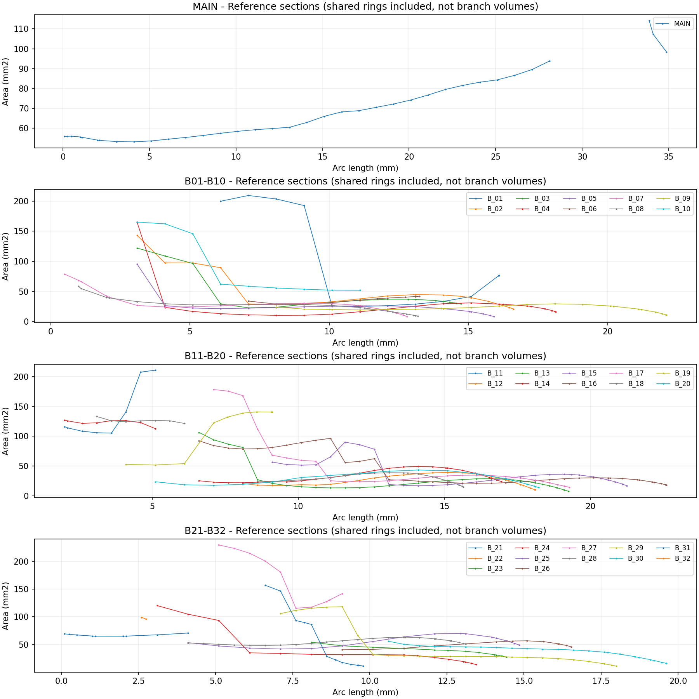
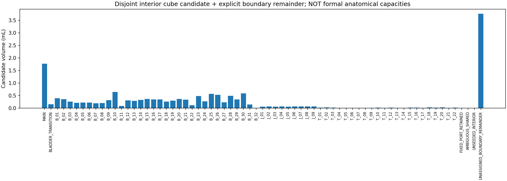
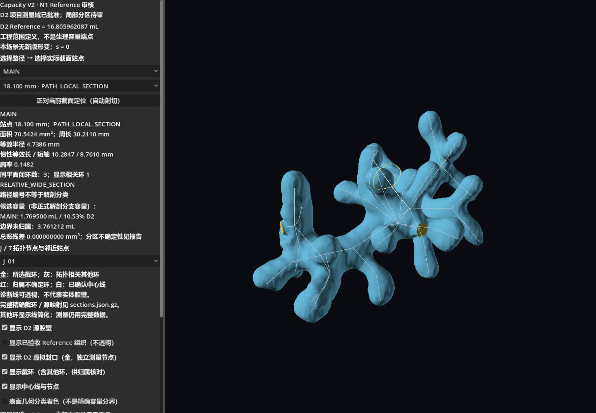
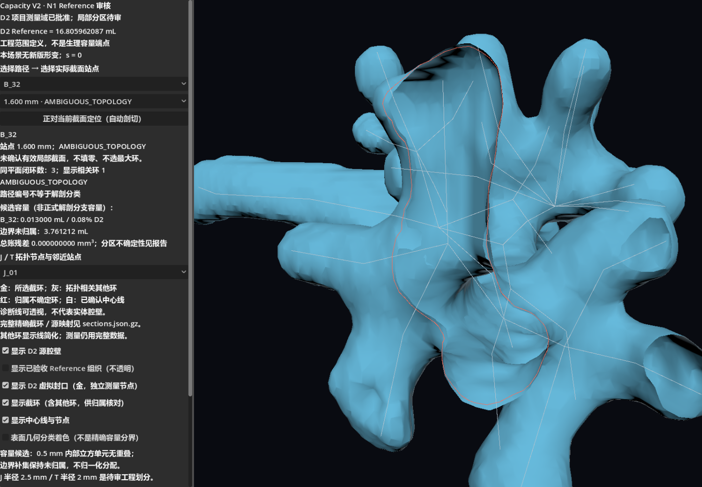
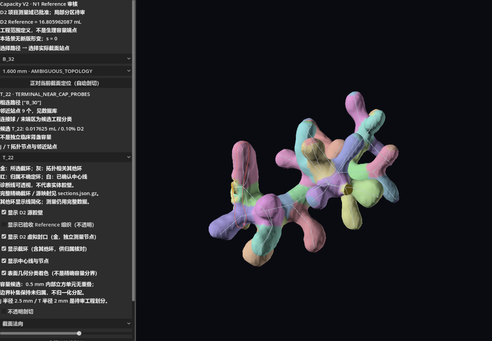

# Capacity V2 N1：参考容量、局部截面与容量目标准备

实施日期：2026-10-15；D2 用户批准日期：2026-10-14。**N0 按用户批准结束；N1 分析与可视化交付，等待人工审核。未实施 N2/N3，未设置 V_min/V_max。**

## 1. 正式 D2 与独立复算

新记录：[D2_approval_2026_10_14_v1.json](../godot_sim/deformation/capacity_v2_n1_v1/D2_approval_2026_10_14_v1.json)。用户明确批准 `C11_R1_IN02_fixed_collar` 为项目容量统计域。BLADDER 截止上游、B_31/B_32 根部和现有 T_01～T_22 封闭范围计入；批准截面外的人工延伸仍排除，不恢复 C06 错删的天然腔壁。无需继续追寻人工通道前数据或内移截面。

从 R1 顶点/面数组独立计算 **16805.962087430176 mm³ = 16.805962087430178 mL**。未从旧报告复制常数。四个原点有向三角面积分、trimesh 和三个轴向散度积分的最大差为 **8.5001011e-07 mm³**；边界边/非流形边/退化面均为0，水密、绕序一致。

该精度仅表示同一网格的数值一致性。单位沿用已验收的 RAS mm；显示减去 `[16,16,-81] mm`。没有独立重验原 DICOM 标定。工程 D2 定义已批准，不等于独立临床边界或正常容量范围验证。Reference 是中间参考，不能推导正常端点、压力或顺应性。

D2 副本位于新版本 `d2/`，逐文件与 R1 字节一致；保留源面、源顶点重心权重、截面中心/法向/截环/封口索引及 SHA-256。源面ID为-1表示虚拟封口。D2 总积分只算一次封闭边界，不叠加分支或封口“体积”。旧 N0 待批准记录和报告未回写。虚拟封口只在测量节点，未加入 P2 腔体、组织或碰撞网格。

## 2. 截面数据库与归属方法

完整精确数据库：[sections.json.gz](../godot_sim/deformation/capacity_v2_n1_v1/sections.json.gz)；便于表格查看的量测值：[sections.csv](../godot_sim/deformation/capacity_v2_n1_v1/sections.csv)。压缩只减少文件大小，不降低浮点精度。

共 **1072 个站点**：MAIN、B_01～B_32、BLADDER_TRANSITION 和两条保留的注水固定管壁短段；9个 J 和22个 T 以所有相连路径距端点2 mm内的站点探针统计。常规间距1 mm，J_05/J_09相关分支及短接口0.5 mm，并补充距端点0.1/0.25/0.5/1/2 mm站点。实际站点坐标、弧长和法向全部保存。

位置严格在既有控制折线上；法向采用前后0.25 mm中心线弦，不移动标记。长度/曲折度和控制点折转反映现有折线，不宣称已恢复真实连续解剖中心线曲率。

截面解析全部相交边与闭环；选择必须同时满足唯一简单闭环包含站点、既有源顶点路径归属及共享端点拓扑邻域约束。禁止最近环/最大环回退。所有环保留有序源面和边插值映射；新的测量顶点通过 D2 重心权重追溯 CT 顶点。路径标签只是已有工程证据，不是临床材料归属。

归属门槛：自身边界长度票≥0.10，非相邻路径票≤0.10；自身≥0.70且无虚拟封口段才标局部截面，其余有效环标共享连接。阈值只控制几何审核分类，不是生理阈值；未放宽门槛来增加通过数量。嵌套环或偏心孔洞不静默填平。

| 截面状态 | 数量 | 使用范围 |
| --- | ---: | --- |
| AMBIGUOUS_TOPOLOGY | 422 | 候选环尺寸保留，但不填入有效局部值 |
| MULTIRING_WITH_HOLE_UNRESOLVED | 2 | 嵌套/孔洞需复核，不使用外环面积冒充净面积 |
| OUTSIDE_APPROVED_D2_CUTOFF | 8 | BLADDER远端已批准排除，不是新的几何失败 |
| PATH_LOCAL_SECTION | 498 | 路径局部几何量，可用于候选尺度 |
| SHARED_JUNCTION_OR_INTERFACE_SECTION | 142 | 共享连接/接口，不是独占分支截面 |

长短轴采用面积二阶矩等效椭圆直径，扁率=`1-短轴/长轴`；不是包围框，也不是经过医学确认的肾盂径线。相对宽/窄由有效局部面积四分位标记，不能诊断狭窄。

### 全路径统计

| 路径 | 已采样长度 mm | 曲折度 | 局部面积最小/中位/最大 mm² | 扁率最小/中位/最大 | 局部/共享/待定 |
| --- | ---: | ---: | --- | --- | --- |
| MAIN | 35.869 | 1.0089 | 53.195 / 61.750 / 93.773 | 0.122 / 0.184 / 0.421 | 30/6/9 |
| BLADDER_TRANSITION | 7.158 | 1.0000 | 59.670 / 61.190 / 61.585 | 0.271 / 0.275 / 0.283 | 5/4/8 |
| B_01 | 18.082 | 1.0000 | 25.043 / 26.695 / 33.637 | 0.157 / 0.168 / 0.304 | 5/7/15 |
| B_02 | 16.712 | 1.0006 | 21.072 / 33.042 / 44.905 | 0.061 / 0.117 / 0.278 | 15/4/7 |
| B_03 | 14.831 | 1.0180 | 23.018 / 32.223 / 37.265 | 0.256 / 0.296 / 0.318 | 13/4/7 |
| B_04 | 18.240 | 1.0015 | 10.461 / 19.736 / 31.195 | 0.023 / 0.073 / 0.298 | 20/1/7 |
| B_05 | 16.020 | 1.0019 | 8.440 / 22.398 / 26.739 | 0.015 / 0.368 / 0.436 | 17/1/7 |
| B_06 | 13.738 | 1.0000 | 29.177 / 32.985 / 38.136 | 0.193 / 0.247 / 0.546 | 6/4/13 |
| B_07 | 12.897 | 1.0091 | 8.499 / 26.348 / 30.572 | 0.032 / 0.111 / 0.203 | 15/5/2 |
| B_08 | 13.278 | 1.0000 | 9.217 / 25.172 / 33.308 | 0.029 / 0.175 / 0.248 | 16/4/3 |
| B_09 | 22.211 | 1.0412 | 11.280 / 20.883 / 29.640 | 0.133 / 0.289 / 0.381 | 20/0/12 |
| B_10 | 17.532 | 1.0000 | 52.072 / 54.882 / 62.329 | 0.271 / 0.302 / 0.446 | 6/3/18 |
| B_11 | 7.949 | 1.0098 | 未确认 | 未确认 | 0/8/17 |
| B_12 | 18.195 | 1.0486 | 10.020 / 23.843 / 39.126 | 0.021 / 0.187 / 0.370 | 26/0/20 |
| B_13 | 19.351 | 1.0001 | 7.455 / 19.033 / 28.678 | 0.006 / 0.046 / 0.135 | 27/4/17 |
| B_14 | 17.042 | 1.0232 | 21.918 / 30.689 / 49.333 | 0.182 / 0.300 / 0.361 | 26/8/9 |
| B_15 | 21.345 | 1.0069 | 16.722 / 24.727 / 36.166 | 0.048 / 0.080 / 0.341 | 22/8/22 |
| B_16 | 22.669 | 1.0835 | 18.182 / 24.635 / 30.230 | 0.009 / 0.056 / 0.127 | 25/13/17 |
| B_17 | 19.369 | 1.0025 | 14.317 / 25.877 / 34.556 | 0.108 / 0.178 / 0.357 | 22/8/18 |
| B_18 | 15.746 | 1.0154 | 14.962 / 29.197 / 38.687 | 0.009 / 0.099 / 0.123 | 20/7/14 |
| B_19 | 9.576 | 1.0000 | 51.610 / 52.609 / 54.103 | 0.144 / 0.213 / 0.305 | 3/6/10 |
| B_20 | 18.323 | 1.0668 | 13.820 / 26.011 / 43.261 | 0.001 / 0.100 / 0.174 | 19/0/9 |
| B_21 | 9.342 | 1.0000 | 67.445 / 69.041 / 70.637 | 0.134 / 0.135 / 0.135 | 2/7/10 |
| B_22 | 6.296 | 1.0000 | 未确认 | 未确认 | 0/0/16 |
| B_23 | 14.531 | 1.0490 | 27.297 / 38.551 / 54.138 | 0.041 / 0.081 / 0.106 | 12/0/12 |
| B_24 | 13.548 | 1.0144 | 13.686 / 29.755 / 34.897 | 0.181 / 0.255 / 0.293 | 13/3/7 |
| B_25 | 14.944 | 1.0000 | 41.793 / 54.396 / 70.067 | 0.022 / 0.111 / 0.182 | 16/0/8 |
| B_26 | 16.632 | 1.0326 | 40.480 / 51.070 / 56.669 | 0.091 / 0.153 / 0.273 | 13/0/13 |
| B_27 | 10.689 | 1.0000 | 未确认 | 未确认 | 0/10/21 |
| B_28 | 13.135 | 1.0000 | 48.279 / 54.086 / 63.142 | 0.263 / 0.335 / 0.447 | 24/0/12 |
| B_29 | 18.096 | 1.0139 | 10.956 / 26.616 / 31.984 | 0.020 / 0.085 / 0.170 | 21/6/18 |
| B_30 | 19.719 | 1.0224 | 15.794 / 40.621 / 55.869 | 0.072 / 0.216 / 0.332 | 24/0/25 |
| B_31 | 9.882 | 1.0000 | 12.402 / 17.465 / 28.486 | 0.024 / 0.123 / 0.143 | 5/7/17 |
| B_32 | 2.844 | 1.0000 | 未确认 | 未确认 | 0/3/12 |
| IN_01 | 1.000 | 1.0000 | 9.515 / 9.598 / 10.055 | 0.016 / 0.037 / 0.050 | 4/1/0 |
| IN_02 | 0.857 | 1.0000 | 9.249 / 9.845 / 11.070 | 0.069 / 0.125 / 0.178 | 6/0/0 |

IN_01/IN_02仅统计 D2 保留的1 mm与约0.857417 mm段，不把被排除的远端管道计入。最小局部截面站点、坐标、周长/等效半径/长短轴范围、控制点转角及全部候选环统计见 [path_statistics.json](../godot_sim/deformation/capacity_v2_n1_v1/path_statistics.json)。若“未确认”，不是尺寸为0。

### J/T 探针覆盖

| 节点 | 相连路径 | 探针数 | 已确认几何探针面积范围 mm² |
| --- | --- | ---: | --- |
| J_01 | MAIN, B_01, B_06, B_09, B_10 | 31 | 98.406 / 107.301 / 114.099 |
| J_02 | B_01, B_02, B_03, B_04, B_05 | 31 | 76.178 / 76.631 / 77.085 |
| J_03 | B_06, B_07, B_08 | 19 | 38.136 / 42.305 / 78.852 |
| J_04 | B_10, B_11, B_19 | 21 | 116.020 / 116.020 / 116.020 |
| J_05 | B_11, B_12, B_13, B_14, B_15, B_16, B_17, B_18, B_31 | 73 | 127.071 / 127.071 / 127.071 |
| J_06 | B_19, B_20, B_21 | 19 | 64.965 / 69.245 / 140.858 |
| J_07 | B_21, B_22, B_26, B_27 | 27 | 未确认 |
| J_08 | B_22, B_23, B_24, B_25 | 25 | 未确认 |
| J_09 | B_27, B_28, B_29, B_30, B_32 | 43 | 130.342 / 136.152 / 141.961 |
| T_01 | B_02 | 7 | 21.072 / 28.590 / 42.182 |
| T_02 | B_03 | 7 | 29.603 / 33.634 / 37.225 |
| T_03 | B_04 | 7 | 16.603 / 21.322 / 28.879 |
| T_04 | B_05 | 7 | 8.440 / 16.546 / 21.936 |
| T_05 | B_07 | 7 | 8.499 / 18.157 / 27.576 |
| T_06 | B_08 | 7 | 9.217 / 12.718 / 22.467 |
| T_07 | B_09 | 7 | 11.280 / 15.982 / 25.579 |
| T_08 | B_12 | 9 | 10.020 / 18.990 / 36.122 |
| T_09 | B_13 | 9 | 7.455 / 16.764 / 26.749 |
| T_10 | B_14 | 9 | 23.962 / 37.203 / 46.942 |
| T_11 | B_15 | 9 | 16.788 / 26.625 / 35.678 |
| T_12 | B_16 | 9 | 18.182 / 23.333 / 29.933 |
| T_13 | B_17 | 9 | 14.317 / 21.663 / 31.065 |
| T_14 | B_18 | 9 | 14.962 / 24.916 / 38.289 |
| T_15 | B_20 | 7 | 13.820 / 19.671 / 35.481 |
| T_16 | B_23 | 7 | 27.297 / 31.689 / 39.359 |
| T_17 | B_24 | 7 | 13.686 / 19.024 / 29.755 |
| T_18 | B_25 | 7 | 49.123 / 61.416 / 70.067 |
| T_19 | B_26 | 7 | 45.777 / 51.393 / 56.669 |
| T_20 | B_28 | 9 | 50.994 / 56.827 / 63.142 |
| T_21 | B_29 | 9 | 10.956 / 19.313 / 24.613 |
| T_22 | B_30 | 9 | 15.794 / 22.522 / 35.442 |

节点统计包含共享截面，不能把其面积解释为一个唯一横截面，更不能相加得到节点容量。各类原始探针状态和源坐标都有记录。

### 异常和高复杂度区域

共 **35 对相邻有效站点**触发复核：相邻面积比超过1.35或切向角超过20°。详见 [section_anomalies.json](../godot_sim/deformation/capacity_v2_n1_v1/section_anomalies.json)。这是采样连续性提示，原因候选包括控制折线方向变化、进入共享连接以及真实参考形态变化，不等于已诊断病理狭窄。图中无效站点断线，不跨缺失值伪造平滑曲线。

- J_05：B_11上游、B_12～B_18七条天然下游和B_31接口；共9条相连路径，所谓八条下游包含接口，不能误写为八条天然分支。
- J_09：B_27上游、B_28～B_30天然下游及B_32接口，需共同查看。
- B_32全长约2.843529 mm，15个站点中3个共享、12个归属待定，没有独占局部截面。候选环面积/长短轴仍保存，但不作为独立管径控制依据。
- B_31有5个局部、7个共享、17个归属待定站点；与J_05一起审核，不再沿所有天然分支扩散接口参数。
- B_27:25与B_30:4发现偏心嵌套环/孔洞情况，标MULTIRING_WITH_HOLE_UNRESOLVED；外环候选面积分别约151.755和205.051 mm²，不当作有效净截面。
- BLADDER_TRANSITION前8个站点位于用户批准截止面外，保留为排除证据；不把它们当域内测量遗漏。



## 3. 无重叠局部容量：候选账，不是正式解剖分区

本轮没有可靠建立全域连续的独占分支容量。采用明确可审计的候选：D2 内互不重叠的轴对齐立方单元；中心到壁距离须超过半对角线+0.0002 mm，并通过3/5奇数射线符号一致性。使用中心化float32空间查询，所以这是保守计算筛查，非形式化精确内点证明。

每个内部单元只有一个标签。中心线种子只在距单元中心≤0.75h时采用，且中心至表面距离大于0.866h：该直线配对受局部内球保护，不通过近邻跨壁绑定。多路径种子冲突不使用。位移尚未求解；标签仅在六邻接内部单元图上做多源测地传播，近而不相连的分支不能跨空隙传播。

J候选共享区半径2.5 mm，T候选末端区半径2 mm，且必须属于该节点相连路径的测地所有者；多个节点冲突则归共享未定。半径是显式工程边界，不是医学肾盏尺度。网格侵蚀可能断开细连接，无种子成分保留未归属；本例该分辨率内部图为一个分量，无无种子单元。

0.5 mm网格共 **104,358 个内部单元，13.044750000 mL**；边界补集 **3.761212087 mL（22.380%）**明确不分配。这个补集是精确D2减去候选内部单元量的账目项，不是另一个已分割解剖器官。

各候选标签加未归属项之和为 **16.805962087430178 mL**，数值残差 **0 mm³**。这种守恒不意味着已完成区域解剖验证；没有归一化放大内部标签填满边界，也没有累加重叠的截面积积分。

| 候选区域 | 内部单元/补集容量 mL | D2比例 |
| --- | ---: | ---: |
| MAIN | 1.769500 | 10.529% |
| BLADDER_TRANSITION | 0.153750 | 0.915% |
| B_01 | 0.393500 | 2.341% |
| B_02 | 0.361250 | 2.150% |
| B_03 | 0.258750 | 1.540% |
| B_04 | 0.211750 | 1.260% |
| B_05 | 0.223875 | 1.332% |
| B_06 | 0.221750 | 1.319% |
| B_07 | 0.195250 | 1.162% |
| B_08 | 0.207250 | 1.233% |
| B_09 | 0.322750 | 1.920% |
| B_10 | 0.647125 | 3.851% |
| B_11 | 0.089000 | 0.530% |
| B_12 | 0.307375 | 1.829% |
| B_13 | 0.285250 | 1.697% |
| B_14 | 0.325625 | 1.938% |
| B_15 | 0.366875 | 2.183% |
| B_16 | 0.349000 | 2.077% |
| B_17 | 0.351125 | 2.089% |
| B_18 | 0.260000 | 1.547% |
| B_19 | 0.302750 | 1.801% |
| B_20 | 0.369750 | 2.200% |
| B_21 | 0.341125 | 2.030% |
| B_22 | 0.115000 | 0.684% |
| B_23 | 0.478750 | 2.849% |
| B_24 | 0.270750 | 1.611% |
| B_25 | 0.568500 | 3.383% |
| B_26 | 0.533375 | 3.174% |
| B_27 | 0.230500 | 1.372% |
| B_28 | 0.495375 | 2.948% |
| B_29 | 0.351250 | 2.090% |
| B_30 | 0.585125 | 3.482% |
| B_31 | 0.149000 | 0.887% |
| B_32 | 0.013000 | 0.077% |
| J_01 | 0.059500 | 0.354% |
| J_02 | 0.065875 | 0.392% |
| J_03 | 0.059625 | 0.355% |
| J_04 | 0.065000 | 0.387% |
| J_05 | 0.055250 | 0.329% |
| J_06 | 0.065500 | 0.390% |
| J_07 | 0.065125 | 0.388% |
| J_08 | 0.065500 | 0.390% |
| J_09 | 0.066000 | 0.393% |
| T_01 | 0.017500 | 0.104% |
| T_02 | 0.029500 | 0.176% |
| T_03 | 0.017625 | 0.105% |
| T_04 | 0.010375 | 0.062% |
| T_05 | 0.009875 | 0.059% |
| T_06 | 0.012250 | 0.073% |
| T_07 | 0.012500 | 0.074% |
| T_08 | 0.011500 | 0.068% |
| T_09 | 0.010875 | 0.065% |
| T_10 | 0.017500 | 0.104% |
| T_11 | 0.013250 | 0.079% |
| T_12 | 0.018625 | 0.111% |
| T_13 | 0.014750 | 0.088% |
| T_14 | 0.014000 | 0.083% |
| T_15 | 0.014875 | 0.089% |
| T_16 | 0.018625 | 0.111% |
| T_17 | 0.014250 | 0.085% |
| T_18 | 0.026000 | 0.155% |
| T_19 | 0.022125 | 0.132% |
| T_20 | 0.030750 | 0.183% |
| T_21 | 0.013750 | 0.082% |
| T_22 | 0.017625 | 0.105% |
| FIXED_PORT_RETAINED | 0.004250 | 0.025% |
| AMBIGUOUS_SHARED | 0.000000 | 0.000% |
| UNSEEDED_INTERIOR | 0.000000 | 0.000% |
| UNASSIGNED_BOUNDARY_REMAINDER | 3.761212 | 22.380% |

上述各行全部是候选工程账目，不是临床独立分支容量。内部单元、原点、格点、测地前驱、路径所有者、区域标签和最近D2/源面及重心坐标均保存；最近面只用于溯源，未用于无约束供体绑定。

### 边界与分辨率敏感性

0.75 mm时内部量为 **11.358984375 mL**，边界余量 **5.446977712 mL**；0.5 mm边界余量减少约 **1.685765625 mL**。细分辨率仍有较大余量，不能声称局部容量已收敛。

对J/T候选半径另做0.75/1/1.25倍敏感性，所有方案独占标签+未归属均守恒，但各区变化说明边界仍需审核；数值见 [partition_resolution_sensitivity.json](../godot_sim/deformation/capacity_v2_n1_v1/partition_resolution_sensitivity.json)。这些变化不是生理置信区间。不移动已批准D2截面做新的边界搜索；N0的局部截面差分保留为历史证据，非临床容量不确定性。



正式局部容量如确有必要，下一步需人工批准共享区域/连接截面后建立经检验的体积分区或自适应切割单元；在此之前保持候选和未归属，不宣称上述表格满足独占解剖容量标定。

## 4. 双向形变设计与医学资料

详见 [局部形变设计与医学标定准备](kidney_irrigation_capacity_v2_n1_design.md)，比较局部截面放样、径向场、形状保持约束优化和连续体模型。推荐可信截面尺度+拓扑局部径向初始场+离线形状/接触/容量约束优化；不整体缩放，不用旧0.2 mm场推导端点。

参数表 [capacity_target_template.json](../godot_sim/deformation/capacity_v2_n1_v1/capacity_target_template.json)列出 **65 个候选区域参数**，Reference值为0，Contracted/Expanded目标、响应权重、V_min/V_max与生理量均为null。它是设计表，没有生成形变。单个容量约束不能唯一确定全部局部位移，仍需区域先验、形状保持、固定区、组织相对运动和接触约束。

本轮重新阅读成人离体顺应性、健康成人补液影像、CT肾盂肾盏静态测容及灌注模型原始研究，并逐项核对其测量范围与D2的差异。没有直接适用的正常成人容量端点；未读到的健康组数据不填入。生理标定路线需要同域影像/实验及状态、出口、漏液与不确定性；演示路线需用户另批不对称工程端点并标待标定。具体来源链接、阅读范围和待批准项见设计文档，旧医学证据报告不改写。

## 5. 实际测试、运行与保护

- Python自动测试 **19/19通过**，失败0、错误0；含旁边更大但不连通的截环、不选最大环、嵌套环/偏心孔洞拒绝、面积惯性、源面映射、固定输入及候选账守恒。
- 重复完整构建：**30个分析产物字节一致**，没有重新计算任何腔体/组织位移。
- Godot compatibility_delivery：**37项通过，11张实际截图**；D2源壁/封口位置float32及面索引与冻结资源逐字节一致；已验收腔体/组织Reference的完整实际顶点、法线、索引与N0回读二进制逐字节一致，3675个固定腔体顶点原位。
- Godot forward_delivery：**37项通过，11张实际截图**；D2源壁/封口位置float32及面索引与冻结资源逐字节一致；已验收腔体/组织Reference的完整实际顶点、法线、索引与N0回读二进制逐字节一致，3675个固定腔体顶点原位。
- 两种后端测量网格法线回读有限，与输入的最大分量差记录在独立检查中；ArrayMesh法线编码量化差单独记录，未降输入精度。
- **2059个受保护文件哈希不变**，六份权威输入SHA-256不变；原OBJ、Marker、拓扑、掩码、旧形变、N0证据、P2场景/控制、主场景和碰撞均未修改。
- 测试设备：Godot4.7 stable，NVIDIA RTX4070Ti，1440×1000；Compatibility/OpenGL和Forward+/Vulkan各真实运行。仅验证静态审核显示，不是P2播放FPS测试。历史18～19FPS限制未解决，未改写为已达标。
- 旧点/边接触与共面重叠基线保留；用户所见无异常只适用于当时视角。本轮无新形变，未无谓重复全量接触扫描；未来新形变需重新做有限几何门禁。

开发中修正了GDScript不支持的格式字符和默认剖切开关与材质不一致；一次旧输出目录PNG写入失败的运行未计为通过，随后在独立最终输出目录重新执行并逐图验证。法线核对另发现分类着色曾把已编码回读的法线重新提交，造成重复编码；现缓存源float32数组，每次着色均从源数组提交，重复切换的实际法线与首次实际法线逐字节一致。未引用顶点的零法线不作为实体面法线比较，真实面片使用顶点的编码差单列。早期verification/compatibility、*_final和*_release不是最终交付验收证据，最终以*_delivery及independent_checks.json为准。未放宽任何几何门槛。

## 6. Godot人工审核

打开 `res://capacity_v2_n1_preview.tscn`，按 **F6**；它是新的独立Reference审核场景，不替换N0或P2。

1. 先看完整D2、金色独立测量封口；当前固定s=0，没有新版充盈控制。
2. 选择MAIN/B路径和实际弧长站点，点击“正对当前截面定位”；查看面积、惯性长短轴、扁率、归属状态及候选容量。
3. 用J/T下拉定位全部节点，重点检查J_05/J_09及B_31/B_32；共享区域不能独立重复计容。
4. 表面分类着色只是可审计的区域示意，不是精确体积分区表面；金色所选截环保持完整精确点，其他拓扑相关环显示线最多64点，其完整精确环和映射仍在数据库。诊断线可透视，不代表实体腔壁。
5. 腔壁、组织和虚拟封口分别显隐；使用不透明剖切和位置滑块、鼠标左键旋转/中键平移/滚轮缩放，R复位。未采用透明混合。
6. 保存审核现场只写新版本user_sessions；请反馈路径/节点、站点ID及认为归属不合理的环。





## 7. 新文件与可重复命令

- `tools/capacity_v2/n1_analysis.py`：固化批准、独立测容、截面/源映射、候选容量账、敏感性、图表及预览数据。
- `n1_design.py`、`n1_report.py`：待批准目标表和源数据驱动报告。
- `test_n1.py`、`n1_verify_outputs.py`、`verify_n1.gd`：自动测试、重复构建和实际ArrayMesh核对。
- `scripts/capacity_v2_n1_preview.gd`、`capacity_v2_n1_preview.tscn`：新的审核UI，复用旧相机/读网格/不透明剖切方法，旧脚本不改。
- `deformation/capacity_v2_n1_v1/`：批准记录、D2逐字节副本、压缩完整几何数据库、CSV/NPY/图表、候选账、目标模板、哈希及真实日志/截图。
- 本报告及`kidney_irrigation_capacity_v2_n1_design.md`；不覆盖旧阶段报告。

在仓库根目录执行（Python需现有NumPy/SciPy/trimesh/Open3D/VTK/Matplotlib环境）：

```powershell
& 'E:/Apps/Conda/miniconda3/envs/FURS/python.exe' godot_sim/tools/capacity_v2/n1_analysis.py
& 'E:/Apps/Conda/miniconda3/envs/FURS/python.exe' godot_sim/tools/capacity_v2/n1_design.py
& 'E:/Apps/Conda/miniconda3/envs/FURS/python.exe' godot_sim/tools/capacity_v2/test_n1.py
$n1Godot = 'E:/Apps/Godot/Godot_v4.7-stable/Godot_v4.7-stable_win64_console.exe'
New-Item -ItemType Directory -Force -Path 'godot_sim/deformation/capacity_v2_n1_v1/verification/compatibility_delivery','godot_sim/deformation/capacity_v2_n1_v1/verification/forward_delivery' | Out-Null
& $n1Godot --path godot_sim --rendering-method gl_compatibility --resolution 1440x1000 res://capacity_v2_n1_preview.tscn -- --n1-verify=res://deformation/capacity_v2_n1_v1/verification/compatibility_delivery | Tee-Object -FilePath 'godot_sim/deformation/capacity_v2_n1_v1/verification/compatibility_delivery/godot_stdout.log'
& $n1Godot --path godot_sim --rendering-method forward_plus --resolution 1440x1000 res://capacity_v2_n1_preview.tscn -- --n1-verify=res://deformation/capacity_v2_n1_v1/verification/forward_delivery | Tee-Object -FilePath 'godot_sim/deformation/capacity_v2_n1_v1/verification/forward_delivery/godot_stdout.log'
& 'E:/Apps/Conda/miniconda3/envs/FURS/python.exe' godot_sim/tools/capacity_v2/n1_verify_outputs.py --repeat-build
& 'E:/Apps/Conda/miniconda3/envs/FURS/python.exe' godot_sim/tools/capacity_v2/n1_report.py
```

上述命令保存实际stdout日志。若自行重跑改变目录，可在验证器中对应修改目录；没有日志时不要把旧日志当新运行证据。数据构建不会运行形变求解或自动推进阶段。

## 8. 验收边界与停止

**已交付**：工程D2固化与容量复核、全路径/J/T局部数据库和异常、候选无重叠内部单元账及显式未归属量、区域形变与标定准备、真实Godot审核和自动测试。

**未解决/需审核**：复杂共享环的归属、两个偏心嵌套环、局部区域容量边界与较大未归属边界层、临床肾盂/肾盏语义及区域响应先验。它们不撤销用户已批准的D2统计范围；本轮也不要求重新移动D2截止面。

等待用户审核局部形态及候选容量分析，选择生理标定或待标定演示路线，并另行批准端点/区域响应与N2。**本轮停止在N1；没有新的Contracted/Expanded、组织求解、P3内镜集成或P4录像。**
