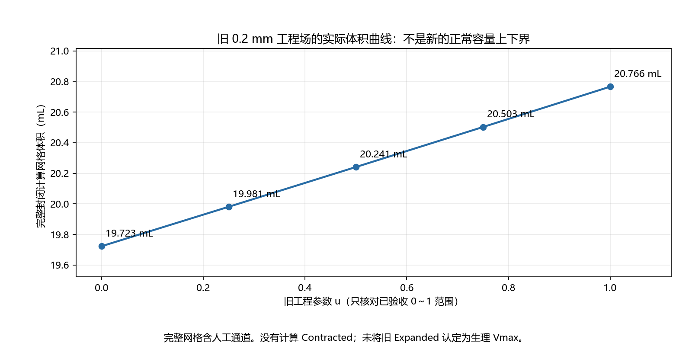
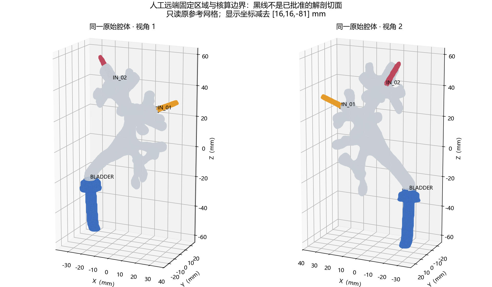

# 肾脏注排水仿真：新版容量模型需求影响分析与实施计划

日期：2026-10-14。版本：Capacity V2 方案草案，**等待用户审阅批准**。

本轮完成资料核对、只读几何容量计算、医学证据调研和路线调整。未生成 Contracted 或新 Expanded，未修改任何已验收形变、原始 OBJ、Marker、拓扑、主场景或碰撞机制，未进入新的 P2.4／P3／P4 开发。

**建议先批准“有效容量测量域的定义与审核”，再决定容量目标与新版双向形变。** 当前完整封闭计算网格体积为 **19,723.077 mm³＝19.723077 mL**，其中包含人工结构。天然集合系统有效参考容量及本例正常最小、最大容量均尚未确定。不要据此直接制作某个固定毫米数的大幅形变。

## 1. 依据、病例条件与既有成果

已阅读 P0～P2.3 计划、实施指导、几何及验收报告，并核对当前输入、形变／预览／控制实现、人工接口、主场景和内镜路径。主要依据：

- [原阶段计划](kidney_irrigation_plan.md)、[P0 指导](kidney_irrigation_p0_guide.md)、[P1 指导](kidney_irrigation_p1_guide.md)。
- [P1.3](kidney_irrigation_p13_result.md)、[P1.4](kidney_irrigation_p14_result.md)、[全天然腔体扩展](kidney_irrigation_full_cavity_result.md)。
- [P1.5 初审](kidney_irrigation_p15_audit_result.md)、[接触判据更正与研究](kidney_irrigation_p15_contact_research_result.md)、[P1.5-R2](kidney_irrigation_p15_r2_result.md)。
- [P2 指导](kidney_irrigation_p2_guide.md)、[P2.1＋P2.2](kidney_irrigation_p2_result.md)、[P2.3 面板与实测性能](kidney_irrigation_p23_result.md)。
- [六份正式输入清单](../godot_sim/deformation/p2/accepted_inputs.json)、`deformation/p2/runtime/`、`scripts/p2/`、`main.tscn`、`kidney_collision.gd` 及 `endoscope_rig.gd`。

用户补充：成人，无结石梗阻或肾积水；CT 是否增强排泄期未知；没有配对形态影像或压力—容量实测数据。这是用户提供的背景，不是本轮临床影像诊断。

旧阶段成果继续有效：72 个已确认标记、37 条路径、P1.2 固定／过渡权重、0.2 mm 腔体工程场、R2 组织工程场、三态插值、状态机及 P2 面板均保留。历史工程完成与新需求需要重新标定是两件事；不回写历史报告的状态或性能结果。P2.3 历史报告中的人工验收状态也不在本轮补写。

| 模块 | 旧含义／现状 | 新需求影响 |
| --- | --- | --- |
| 参考形态 | CT 原形态，旧播放 u=0 | 保留原坐标；明确为中间参考，既不等于空腔，也不等于最小容量 |
| 三态 | Reference、Mid、Expanded；Mid=旧位移的 0.5 倍 | 新版为 Contracted、Reference、Expanded；旧 Mid 作为历史工程状态保留 |
| 形变量 | 腔体最大 0.2 mm；组织最大约 0.1961 mm | 仅为旧小幅工程验证，不是最大生理幅度，不直接取反或乘 10 |
| 容量 | 原流程主要检查体积变化 | 先定义天然测量域，再给出有来源的容量目标并反求局部形变 |
| 组织 | R2 在旧范围通过工程门禁 | 新收缩及更大扩张全部重新验证；原映射不自动适用 |
| 播放／控制 | 唯一 u、参考＋位移、平滑时间曲线 | 复用分层与状态语义；新版增加双向几何、实际容量曲线及反查 |
| 性能 | 本机实际连续播放约 18～19 FPS | 保留未达稳定 30 FPS 的限制；新版必须重新测量，不能假定幅度改变即可解决 |
| 视频与内镜 | 尚未正式实施最终演示 | 外部整体形变之后，切换到已核验指定形态下的一段内镜运动路径 |

## 2. 参考网格的实际容量核算

### 2.1 单位、坐标和方法

使用六份权威哈希核验通过的腔体参考数组及面索引，未经过 Godot 导入后重排。原 OBJ 标头为 RAS；沿用已验收的 **1 Godot 单位＝1 mm** 约定。原场景参考模型没有额外缩放；显示中心化只减去 `[16,16,-81] mm`，不改变容量。

本轮没有原 DICOM 体素标定资料，因此单位沿用现有工程验收，不声称独立重验了医学影像尺度。长度尺度若误差为倍率 c，体积会变为 c³ 倍；数值精度不能消除尺度或分割误差。

有向三角面体积积分：

`V_mesh = Σ dot(a-o, cross(b-o, c-o))/6`

`o` 是计算原点，`a,b,c` 按原面朝向取值。使用 float64、中心化和精确求和；通过 trimesh 独立实现、三个坐标方向的散度积分、多个计算原点复核。**1000 mm³＝1 mL**，不能按 1 mm³＝1 mL 显示。

| 项目 | 本轮结果 |
| --- | ---: |
| 顶点／三角面 | 25,024／50,044 |
| 封闭性／面朝向一致 | 是／是 |
| 边界边／非流形边／退化面 | 0／0／0 |
| 面连通分量／Euler 数 | 1／2 |
| 参考表面积 | 10,812.234 mm² |
| 有向体积 | **19,723.0773625 mm³** |
| 完整封闭网格体积 | **19.7230773625 mL** |
| 不同原点及复核方法数值差异 | 约 1.75×10⁻⁶ mm³ |

这个精度只描述同一网格的计算一致性，不是影像、分割或生理容量的置信区间。水密与面朝向一致也不单独证明整个表面嵌入无自交。本轮未重复全模型大规模相交扫描；沿用已有有限三角形研究的适用边界。

### 2.2 原 B_24 候选的补充复核

对历史记录的面 `[1856,1862]` 做了局部有限交线及最近几何特征距离复核：参考态最小距离约 **0.128199 mm**，在 `1e-12、1e-10、1e-8、1e-6 mm` 容差试验中均未发现正长度有限交线，共面重叠面积为 0。当前计算支持将这一对保留为**历史候选、本轮未确认真实相交**，而非直接作为容量失效的证据。

旧报告的记录不改写；这个结论只针对这对参考态三角面，不扩大为全模型／全状态的无相交证明。初审中“58 对腔体—组织穿越”和“23 对组织自交”也必须按后续有限三角形更正理解，不能继续当作已经证实的真实相交数量。

### 2.3 旧 0.2 mm 工程场的容量曲线

只计算旧验收区间，不外推负值、不产生新位移。

| 旧 u | 完整网格体积 mL |
| ---: | ---: |
| 0 | 19.723077 |
| 0.25 | 19.981044 |
| 0.5 | 20.240931 |
| 0.75 | 20.502740 |
| 1 | 20.766473 |

原旧场相对 Reference 增加约 **1.043395 mL**，约为完整网格参考体积的 5.29%。这不等于正常最大增量。固定面索引和线性顶点插值下，体积实际是三次多项式：

`V_mesh(u) [mm³] = 19723.0773625191 + 1028.0250550469u + 15.3582901047u² + 0.0119093196u³`

所以线性顶点插值不等于线性容量；Reference 也不能据此设为新容量范围的 50%。



## 3. 人工接口为什么阻止直接解释容量

### 3.1 已完成的只读诊断

利用既有三条人工管道固定顶点区域，选择三个顶点均属于同一固定区的面片，记录有向边界环，在内存中试验虚拟封口。**没有删除或裁切源网格，没有改变固定区。** 这只是核算人工结构影响的探查，不是已经批准的解剖容量划分。

| 远端固定面片 | 固定顶点 | 源面数 | 边界边数 | 边界相对最佳拟合平面的最大残差 mm | 质心扇形封口的代数体积代理 mL |
| --- | ---: | ---: | ---: | ---: | ---: |
| BLADDER | 2,793 | 5,545 | 39 | 0.3534 | 2.410545 |
| IN_01 | 397 | 768 | 24 | 0.5038 | 0.138389 |
| IN_02 | 485 | 949 | 19 | 0.4277 | 0.145937 |

固定面片代理之和约 **2.694871 mL**，用方向相反的同一封口计算代数补集约 **17.028206 mL**，代数可加性误差小于 `1e-7 mm³`。

**上述两个数均不得提升为“真实人工容量”或“天然有效参考容量”。** BLADDER、IN_01 边界在投影中不满足相对于质心的星形条件，扇形可能重叠；另一种非重叠投影耳切封口虽能三角化，IN_01 与既有壁面边索引产生冲突，未通过水密检查，已明确标记拒绝。其余耳切封口仅通过拓扑检查，未获得解剖批准或完整封口—壁面相交认证。可加性是代数恒等关系，不能替代空间容量安全证明。

固定区边界也不等于平面入口或原天然腔壁。仅变更一环取面规则，三个代理分别约落在 `2.377～2.447`、`0.129～0.149`、`0.139～0.152 mL`；这是边界算法敏感性，不是生理容量不确定区间。



### 3.2 仍未排除的结构

扣除远端固定片后的补集仍包含 B_31（约 9.882 mm）、B_32（约 2.844 mm）、BLADDER_TRANSITION（约 7.158 mm）等过渡结构。B_31、B_32 不是完全固定管道，它们的运动权重不能直接用作天然腔体容量边界。

还需确认 BLADDER 名称对应的人工通道与真实输尿管／UPJ 的截止位置、天然末端 T_01～T_22 封口的分割含义、人工入口是否替换了原有腔壁。Marker 提供连接关系，但不能唯一恢复添加人工结构前的天然壁面。

### 3.3 推荐的可审计容量定义

分三层保存，避免混称：

1. **D0：完整计算网格**。本轮 V_mesh,reference＝19.723077 mL；适合程序核对，含人工部分。
2. **D1：人工固定面片代数核算代理**。仅用于诊断；明确不能用于有效容量或正常范围比较。
3. **D2：经人工批准的天然集合系统测量域**。定义肾盂、肾盏、天然末端范围及 UPJ／输尿管截止面，排除人工灌注通道及不属于此域的过渡空间。**尚未建立。**

下一步先找添加通道前的分割或模型；若不存在，提出局部截面与人工孔虚拟补壁候选，供用户／解剖审核者确认。只在独立的**测量派生模型**上进行，不覆盖 OBJ，也不自动改变正式渲染拓扑。

每个候选记录源面／顶点、截面法向和位置、局部拓扑范围、新增交点和封口、单位、哈希及批准状态。禁止用无限全局平面误裁邻近天然分支。验证单环／多环归属、封口朝向、水密性、有限相交、互补可加性及切面位置敏感性；变形后相同材料边界的虚拟封口须重新核算。

如无法确定天然壁面补形或截止位置，提供多个明确命名的测量域及差异，保留有效容量未确定；不能仅挑选一个看起来合理的数值。D2 中实际壁面沿用原顶点映射，虚拟封口只用于测容，后续不得对封口体积重复计入。

## 4. 医学依据与容量目标

详见独立 [医学证据表与资料缺口](kidney_irrigation_capacity_v2_evidence.md)。现有研究支持考虑非线性、个体差异及加载历史，但不能直接给本例一个正常最小、最大容量。成人离体试验与本例未知成像状态／开放出口条件不同；儿童肾盂、梗阻性肾积水和健康成人径线变化也不能互相替代。[成人离体原始研究](https://e-century.us/files/ajceu/14/2/ajceu0170543.pdf)、[健康成人补液影像研究](https://pmc.ncbi.nlm.nih.gov/articles/PMC12381993/)。

| 参数 | 当前可交付值／状态 | 依据类别 |
| --- | --- | --- |
| V_mesh,reference | 19.723077 mL，完整人工封闭模型 | 几何计算 |
| V_reference（D2 有效容量） | 未确定，不用 17.028206 替代 | 需测量域审核 |
| V_min、V_max（正常生理端点） | 未确定 | 需外部标定及适用性审核 |
| ΔV_contract、ΔV_expand | 未确定；待端点给定后分别计算 | 不假定对称 |
| 各区域顺应性／压力／流量 | 未确定 | 需材料或实验数据 |
| Contracted 可达到的几何下界 | 未计算；几何可行不等于正常生理 | 后续有约束求解 |

不直接采用教材常见肾盂容量概括、儿童数据、肾积水容量、压力阈值或单个指数模型来指定本例上下界。压力—容量需初始状态、解剖测量域、出口和器械条件；没有这些条件不能由 19.723 mL 反推出压力或最大容量。

两条可批准路线：

- **标定路线**：以同域个体配对影像／实验为优先，或经过专业审核的成人群体资料与迁移方法，给端点及不确定范围；说明测量状态和局部约束。
- **待标定演示路线**：用户明确批准演示端点与不对称局部响应假设，所有显示注明“待标定演示模型”。当前不凭经验填入毫米数或百分比。几何求解先确定可行性，不能把可行上界命名为正常最大容量。

新模型的 Contracted 指指定条件下的模型最小容量，**不等于零容积或真正空腔**。若目标涉及壁面贴合／塌陷，原固定拓扑可能不适用，需要接触及塌陷模型另行审核，不能强压到零。

## 5. 局部容量约束形变：方案比较与推荐

| 方案 | 优点／问题 | 建议 |
| --- | --- | --- |
| 整体缩放、统一 2 mm、旧场乘倍数或取负 | 不能表达不同分支、狭窄部、固定接口；不能保证容量和相交约束 | 不采用 |
| 区域截面参数＋拓扑局部支持＋容量约束优化 | 可追踪各区域体积贡献，复用已确认中心线与权重；无需假造材料常数，但仍是几何模型 | **推荐为下一轮工程实现** |
| 壳／体有限元＋组织接触＋压力耦合 | 可研究材料响应；需要可靠内外壁、体网格、本构、边界及标定 | 作为后续有数据时的独立研究，不冒充当前已具备 |

### 5.1 建立局部几何描述

复用 MAIN、B_01～B_30、J_01～J_09、T_01～T_22 的原中心路径与表面拓扑。按路径站点计算局部截面面积、周长、等效半径、长短轴及方向、狭窄处尺度；临近分叉平面可能切出多环，需通过中心线包含与表面连通归属选环，不能只选欧氏最近环。

天然路径 B 编号本身不等于已确定的大小肾盏／盏颈语义。局部肾盂、肾盏、连接区类别需要一次语义确认，**不要求重新标记 72 个坐标**。局部半径与允许幅度应不同；截面扁平化／展开可以用不同主轴参数，避免天然末端单纯沿中心线横向拉大。

### 5.2 位移基与容量反求

建立沿路径的局部径向／壁法向位移基，末端增加端帽向外及回缩分量。支持范围由路径拓扑邻域和表面距离共同限定；只在真实相连分叉融合方向。相邻但不相连分支不能因距离近就共享全部候选。

J_05 多分叉、J_09 与短 B_32 采用共享连接区域和渐变支持，复用 P1.2 边界权重。三条人工管道 **3,675 个固定顶点严格零位移**；B_31、B_32 的过渡不能改为整体固定，也不能再串入远处天然分支。旧掩码作为经验证的约束输入，不偷偷重算；若新需求证明需改变约束，另建版本并单独申请。

设 `x(q)` 为局部参数 q 生成的表面，推荐约束问题：

`min E_local_target + E_shape + E_smooth + E_contact`

`subject to V_D2(x(q)) = V_target, fixed vertices = reference, geometry gates satisfied`

单个全局容量不能唯一确定几万顶点的位移；局部区域目标、形状保真与正则项必须明示。容量用每次真实网格／虚拟封口积分校正，而不是把位移倍数当成容量倍数。用小增量、信赖域及容量延续逐步接近目标；出现折叠、相交或组织不可行就回退并报告目标不可达，不靠放松门禁强行完成。

Contracted 与 Expanded 分别求解；不默认互为负场。原 0.2 mm 只可作为已验证数值尺度或初始调试基准，不能直接决定新终点。各区域给出真实体积贡献与目标残差，人工区域单独记录，防止总量满足但由少数分支异常鼓出实现。

### 5.3 保存与插值

尽量保持原参考顶点与面索引，保存两侧经过审查的关键形态，而非预设一个大位移线性外推就足够。Reference 在 `s=0` 必须与原参考逐值一致。若确需变更拓扑，应另立派生模型审批，本计划不授权。

每个线性顶点插值段的体积是三次函数；计算并保存实际 `V_D2(s)`、导数和反查区间。要求容量按新状态参数严格单调，检测局部回退或极值。使用区间求根／单调查表反求参数，核验实际容量残差；非单调段不能直接反查或掩盖。

组织与腔体使用同一状态和关键帧区间参数同步。关键帧越多并不自动越安全；需验证段间位置连续、法线变化与接触关系，Reference 两侧若切向不一致需改善过渡并重新测容。

## 6. 组织协调、疑似穿模与全过程安全

### 6.1 先复核疑似穿模，再扩大幅度

将用户报告的局部疑似穿模列为高优先级风险。待下一阶段收集或复现当时的场景、形态参数、相机及剖切位置，导出**实际 ArrayMesh** 的世界坐标与索引，和原 float64 计算坐标、中心化 float32 显示坐标对照。

分别判断：正长度有限三角面穿越、原有共面重叠、点／边接触、近距离数值候选、双面渲染及剖切边缘造成的显示现象。输出面编号、有限交线或最小距离、局部截面与同视角对比；不能凭截图直接判定为正常接触，也不能凭旧五档通过否定用户观察。

原始状态已有的问题与形变新增问题分开列出，不以候选对编号变化代替穿越程度。共面配对面积和可能重复计数，不叫穿透面积；没有可信体内外关系时不报告伪精确穿透深度。禁止通过隐藏局部、整体偏移或扩大相交容差消除问题。

### 6.2 新组织跟随

旧组织是一个连通表面，未可靠标注为独立内壁／外壁材料层；普通最近距离不是壁厚，不能由表面体积声称组织不可压缩已满足。R2 的 F03（61933、61934）及 F04（30663）解剖归属仍未确认。

参考态关系不变时保留 139 个真实共点的对应记录；接触、近壁、自由传播和远区约束继续分级。更大形变下需重新验证接触活动集及映射稳定性：可靠对应精确跟随，不确定近邻使用拓扑限制和软约束，不把所有近壁点硬绑定到最近腔体面。

先求腔体候选，再用接触一致性及组织局部质量约束求跟随；若组织不可行，反馈限制腔体候选，而非忽略组织失败。检查远区锚点及外表面是否过度限制目标；不得无说明地解除旧约束或冻结整个 J_09 区域。必要时提出新的边界模型并独立批准。

### 6.3 必须通过的门禁

- 固定区严格零位移；参考回归精确；单位、面索引与共同显示变换一致。
- 腔体与组织坐标／法线有限，无新增退化、翻面、有限自交及相互真实穿越；原有接触与确认缺陷保留独立记录。
- 暂沿用组织最大边位移梯度 ≤0.2、面积比 0.8～1.35 作为工程门禁。它们不是生理标定；目标若不可行，报告阻塞，不自动放宽。
- 按 MAIN、全部 B／J／T、B_31／B_32、三人工接口、F01～F04、组织外层代理及远场逐区报告，重点审查 J_05、J_09 与短过渡。
- 参考、两端点及各段中间档检查；增加接触邻近和质量快速变化处的自适应采样。线性插值段用解析面积／法线方向界；容量用实际多项式检查。
- 若要求“全过程无穿越”，需采用有误差界的连续三角形碰撞／扫掠检查，包括相邻面正常共享边的处理。只做五档或密集采样时，结论必须标为**采样范围通过**，不能称为连续无碰撞证明。
- float64 与真实 Godot float32 坐标均复核；不改几何精度，不通过接触容差膨胀使门禁通过。

没有已识别内外壁就不能给出真实壁厚安全结论；若后续资料提供明确材料边界，再加入局部厚度和材料体积约束。若需要修复参考几何，仅能提出独立派生参考候选，先审核再决定是否采用，不能覆盖原 OBJ。

## 7. 新参数和 P2 控制系统改造

### 7.1 统一术语

| 量 | 定义 | 不代表什么 |
| --- | --- | --- |
| s∈[-1,1] | 有符号模型状态；-1 Contracted、0 Reference、+1 Expanded | 不代表临床真实充盈比例或时间 |
| λ∈[0,1] | 某一已验证关键形态段内的几何插值参数 | 不自动等于该段容量比例 |
| V_D2(s) | 经批准测量域的实际几何体积，mL | 不等于累计灌入量 |
| r=(V−V_min)/(V_max−V_min) | 已定义模型容量范围的归一化位置 | 不表示“膀胱式空满”，Reference 的 r 不预设 0.5 |
| τ=elapsed/duration | 演示时间进度 | 不代表容量或压力 |
| V_in、V_out、ΔV_retained | 累计流入、累计流出、净液体滞留变化 | 不能仅从顶点形变唯一求得 |

`V_min < V_reference < V_max` 应在同一 D2 域测量并验证。当前 D2 与端点未批准，相关值保留为空。UI 可以显示 D0 完整体积，但必须明确命名“含人工部分的计算网格体积”，不得伪装成有效容量。

### 7.2 推荐容量驱动的演示控制

在容量目标和几何曲线可用之后，复用 P2 的 controller／player／panel 分离方式，新增版本：

`τ = clamp(elapsed / duration,0,1)`

`V_command = V_start + (V_target−V_start)*(3τ²−2τ³)`

`s = inverse_V(V_command)`，然后同一 `s / λ` 同步更新两份几何。

这是一条**参数化演示时间线**，不是实测流量或压力响应。完整行程时间与部分行程比例可以按容量距离配置，注明游戏时间或墙钟时间；不得把界面中的 mL 差／秒自动命名为真实灌注流量。

| 操作／事件 | 新版预期行为 |
| --- | --- |
| 从 Reference 注水 | 从 s=0 增大容量，目标通常为 Expanded 或合法的中间容量 |
| 从 Reference 排水 | 从 s=0 减小容量，目标通常为 Contracted 或合法的中间容量 |
| 任意位置反向 | 从实际当前容量重新起段，位置连续；旧命令失效 |
| 保持 | 取消当前段并保持当前几何；不暗示真实肾脏停止产尿 |
| 暂停／继续 | 独立 paused 标志；冻结／继续当前演示段，不等于 HOLDING |
| 手动 s 或容量 | 取消自动运动，进入 HOLDING；程序刷新滑块不触发接管 |
| 恢复 Reference | 返回 s=0 的明确命令；与“排到最小”分开 |
| 重置 | 取消运动与暂停，立即回原 CT Reference；不把它叫作排空 |
| 到达端点 | 停止，标明 CONTRACTED 或 EXPANDED；边界状态与运动状态分离 |
| 运动中修改目标／时长 | 沿用已验收的显式生效规则；下一段生效，或用户明确执行新命令后重建段，不能隐藏跳变 |

可保留 REFERENCE、FILLING、HOLDING、DRAINING 等阶段，加独立端点标签；旧 RESTORED 不再含糊地表示排水最小态。旧 API `set_filling(u)` 在历史场景中保留原义；新版用 `set_state(s)`／容量命令适配器，不将旧 u=0 重新命名为 Contracted。

面板同时显示形态名、s、当前与目标几何容量、相对 Reference 的 ΔV、时间及“待标定”状态；不以相同数字混用目标容量、实际容量和时间进度。Reference 与收缩／扩张分支连接处需测量几何速度变化；至少位置连续，不虚称速度严格连续。

### 7.3 液体守恒的适用条件

未来如具备流量数据，液体滞留变化应按 `dV_liquid/dt = Q_in + Q_urine − Q_out − Q_loss` 核算。几何空间还可能由器械、气体等占据；只有满足相应假设时，几何 ΔV 才能等同于液体净滞留变化。在保持相同腔体容量时仍可有持续等量流入／流出，不能从静止几何推导累计注入量。[灌注与出口阻力原始模型](https://journals.plos.org/plosone/article?id=10.1371/journal.pone.0208209)。

本轮及未标定新版均不引入虚构 mL/s、压力或临床安全标签。文献观察到充排水滞后，但当前没有本例数据；先采用可逆几何演示曲线，明确未建生理滞后，不能将同一曲线往返说成真实物理响应。[猪肾压力—容量原始研究](https://pubmed.ncbi.nlm.nih.gov/3944923/)。

## 8. 外部展示与内镜路径设计

### 8.1 第一阶段：外部整体形变

在新版双网格通过审查后，独立场景展示 Contracted → Reference → Expanded 及反向过程，镜头以固定视角为主，缓慢换角后停留比较。显式标注形态、批准域的容量及校准级别；不将 Reference 显示成 50%。

使用现有稳定的不透明表面、剖切及分别显隐观察腔体和组织，配合参考线、位移图、局部定位体现不同区域响应；不为“看得明显”擅自放大真实位移。剖切是观察手段，不能隐藏已知缺陷。组织大网格不引入未经验证的透明混合方案。

### 8.2 第二阶段：固定形态下的腔内运动

当前入口为 `main.tscn` 中的 EndoscopeRig／相机／灯光；碰撞代理为半径 2 mm 的球。当前主场景未实例化完整器械轴体几何，不应把该球当成已验证的真实内镜模型。相机 FOV 90°、near 0.01、far 300；实际碰撞脚本为一次性静态组织碰撞，不随新形态更新。

现有路径为 `data/organ_2_kidney/lab_6/cavity_path_stone1.json`：88 个点，折线长约 86.533 mm。文件名含 stone1 不构成本例存在结石的医学证据。历史 P0 对加密后的 176 点检查为中心在腔内，但最近腔壁距离仅约 **0.113 mm**，小于 2 mm 代理半径，因此全路径连 Reference 态的代理净空都未通过。该历史采样不是连续扫掠证明。

下一步只能筛选一段可观察肾盂／肾盏且有充分净空的路径；Reference 可作为优先候选展示态，**不能自动判定安全**。针对选定状态检查：

1. 原路径、相机、模型的局部／世界坐标与共同中心化变换。
2. 相机中心、实际器械头部、轴体／弯曲段尺寸及扫掠包络；若真实尺寸未知，只能报告代理几何安全。
3. 沿连续线段或曲线路径的腔壁净空与组织关系，包含姿态、半径和明确工程余量，而非仅检测离散中心点。
4. 近裁剪、视锥、方向和内壁显示；视觉穿墙与实体碰撞分别核对。
5. 展示期间将几何固定在这个明确状态；需要碰撞时，在未来独立场景中离线生成与该冻结形态匹配的代理并核验，不复用原参考静态碰撞去冒充新状态碰撞。

若收缩态无有效通路，选用另一明确状态或合格路径段，不强行穿墙。若希望内镜运动时继续改变形态，则须另立动态扫掠与碰撞验证任务，本次计划不默认包含。固定相机、真实路径运动和动态碰撞分别验收。

最终逻辑固定为：**外部整体注排水形变 → 视角切换并注明选定形态 → 腔内实际路径运动**。镜头时长、路径速度、过渡及录制方法留待 P4；当前不制作录像，也不先行实现三轮自动循环。

## 9. 性能路线与版本迁移

### 9.1 性能现状和优先级

P2.3 在 i7-13700KF／RTX 4070 Ti、Godot 4.7 上的真实连续播放仍约 18～19 FPS，双网格更新约 51～53 ms；法线约 36 ms，ArrayMesh 创建约 11～13 ms。Forward+ 与 Compatibility 均未达到稳定 30 FPS，6 游戏秒约对应 9.5～9.8 墙钟秒。[原性能报告](kidney_irrigation_p23_result.md) 保留原值。

正常播放的诊断回读已删除，颜色已缓存，不能再将它们列为尚未实施的主要优化。新幅度本身不一定增加同拓扑顶点循环成本，但新接触求解、关键帧及内镜检查可能增加离线计算和数据量。

推荐把高代价接触／形变求解放在离线构建；运行时只插值批准关键帧及更新正确法线。先研究保持同一算法结果的原生 CPU 法线与缓冲更新方案，分别测量计算、上传和渲染；不减面、不减幅、不降精度、不跳过法线。实现变化必须导出实际 ArrayMesh，与批准 float32 位置、索引及正确法线比较。

GPU 形变／法线、特殊预计算法线系数等更大调整需独立方案与批准，不能直接以插值两端单位法线替代当前正确法线。新版最终分别实测两个后端的连续播放 FPS、P95、长帧及游戏秒／墙钟秒；30 FPS／33.3 ms 作为展示目标，目前未达标，不与本轮方案完成混淆。

### 9.2 新版资源与保护

建议下一阶段批准后新建以下路径，**本轮只提出结构，没有创建正式新版形变数据**：

```text
godot_sim/deformation/capacity_v2/
  model_manifest.json        # 版本、六份源哈希、批准记录、模型声明级别
  measurement_domain/        # D2 截面、虚拟补壁、来源映射和审核
  capacity_targets.json      # 单位、来源、不确定性、端点及批准状态
  regional_geometry/         # 截面、拓扑局部归属及区域响应假设
  cavity/                    # 两侧批准关键帧；Reference 不变
  tissue/                    # 新范围重新验证的跟随关键帧
  volume_curve/              # 实际容量曲线与反查
  verification/              # 局部、全局、连续及真实运行数据
  runtime/                   # 可被 Git 跟踪的自足运行资源
godot_sim/scripts/capacity_v2/ # 新 player／控制适配／面板
godot_sim/capacity_v2_preview.tscn
```

本轮的 `deformation/capacity_v2_research/` 仅为分析证据目录，不是上述正式模型。新运行资源不得依赖 `.gitignore` 排除的 analysis 缓存。旧 P1／P2 场景继续使用旧 manifest；不能把原有资源路径静默重定向到新模型。

继续保护两个原始 OBJ、72 Marker、人工拓扑与 resolved、P1.2 掩码、全腔体／R2/P2 数组和历史结果、`main.tscn`、内镜控制与碰撞脚本。用户保存的 `TissueReference.visible=false` 保留。新增每轮源哈希、参数、算法版本、有效测量域及批准记录；所有“待标定”与“正式验收”分开。

## 10. 建议的新阶段、验收门槛与风险

原 P2.4 三轮循环及 P3／P4 后续工作暂停排入实施；保留编号历史，新增以下容量模型里程碑，不回写旧阶段完成状态。工作量以数据及审核结果为条件，不给未经验证的工期承诺。

| 阶段 | 实施内容与交付 | 进入下一阶段的门槛 |
| --- | --- | --- |
| N0：容量域与问题复现 | 展示天然／人工边界候选；测量派生封口；复现疑似穿模并有限几何分类 | 用户／解剖审核者批准 D2，或明确其仍未确定；确认缺陷处理路线及原始参考可用性。未定域不发布有效容量 |
| N1：局部描述及容量目标 | 全路径截面与类别；可用医学标定／缺失项；端点配置和不确定性 | 批准标定目标，或明确批准“待标定演示”目标；没有目标不制作大幅端点 |
| N2：双向腔体候选 | 独立求收缩／扩张，体积延续与各区域贡献，关键帧与单调容量曲线 | 三态关系、固定约束、全部局部／全局质量及相交检查通过；实际容量残差可审计 |
| N3：组织与联合几何 | 接触一致性新范围求解；疑似穿模修复；关键帧及段间检查 | 组织工程门禁不放宽；无新增确认穿越／自交；连续与采样结论区分；用户联合预览验收 |
| N4：控制与实时播放 | 新 signed state／容量控制、面板、精度验证与性能优化 | 任意状态反向／暂停／保持／回 Reference 回归；运行数据一致；连续性能实测达标或明确阻塞 |
| N5：双视角演示准备 | 外部对照脚本；冻结状态、内镜子路径、实体代理净空报告 | 选定路径及状态通过几何检查，内外显示人工确认；不冒称动态碰撞验证 |
| N6：P4 镜头与录制 | 具体时长、两阶段镜头、同视角对照、最终素材 | 用户批准脚本；成片与实际容量／校准级别／状态一致，无异常掩盖 |

N2 可提议容量数值残差不超过 `max(目标容量的0.1%, 已证明的测量数值误差)`，这是**待批准的工程精度目标**，不是临床准确度；截面定义和分割不确定性另报。任一阶段的目标不可达、相交或参考缺陷无法判定时停止晋升，提交局部证据，不自动调低检验标准或修改原始输入。

| 主要风险 | 当前证据／影响 | 处理与停止条件 |
| --- | --- | --- |
| 有效容量域不唯一 | 人工结构、过渡段、末端封口语义未审核 | 先审核局部测量域；无法定域就保留有效容量空值 |
| 正常上下界不足 | 无个体配对影像／压力—容量数据 | 取得资料，或明确批准演示模型；不能宣称正常生理真实性 |
| 大幅收缩受拓扑限制 | 狭窄部、分支贴近、可能壁面接触 | 小步延续及接触检查；不强制达到零空腔或不可行目标 |
| 组织映射不再适用 | 旧门禁只覆盖 0.2 mm 腔体场，F03／F04 归属不明 | 新范围全量验证，必要时人工确认；失败不晋升 |
| 疑似穿模未分类 | 可能真实交叉／原接触／剖切显示混合 | 记录具体状态和有限几何证据；不以显隐掩盖 |
| 全过程检查计算量大 | 组织 311,844 个三角面 | 离线 BVH／局部候选＋连续检测；不能用少量采样替代证明 |
| 原内镜路径净空不足 | 参考态采样最小净距 0.113 mm | 重新选段和定形态；无有效段则不制作穿墙镜头 |
| 实时帧预算不足 | 18～19 FPS，法线及网格创建主导 | 单列优化与真实回归；不依靠录像掩盖实际性能 |

## 11. 本轮实际交付、复现与待审事项

### 11.1 已执行与未执行

实际执行：六份输入哈希核对、体积积分及多方法复核、原参考拓扑检查、人工固定面片／封口诊断、旧范围五档体积与解析三次式核对、B_24 指定候选复核、内镜路径清单核对、医学原始资料检索、科学图生成及目视检查。

新增 **12 项自动测试全部通过**，包括单位立方体／四面体、反向面符号、平移与尺度、真实网格封闭性、多方法体积一致性、非线性体积、拒绝错误封口、候选有限距离、受保护文件及重复构建。两次构建的审计 JSON 逐字节一致。**697 个纳入本轮快照的既有文件哈希未变化**，包括六份权威数组；Git 已跟踪文件没有本轮改动。

没有重新进行无必要的大规模接触扫描，没有制作新形变、运行新 Godot 场景或录制视频；本轮图片是原参考数组的静态科学核算图，**不是新形变的 Godot 验收截图**。原阶段 Godot 记录仍引用历史报告。

### 11.2 新增文件

- 本文及 [医学证据与限制](kidney_irrigation_capacity_v2_evidence.md)。
- [只读容量审计程序](../godot_sim/tools/capacity_v2/audit_reference_capacity.py)、[数值测试](../godot_sim/tools/capacity_v2/test_reference_capacity.py)、[科学图生成](../godot_sim/tools/capacity_v2/plot_capacity_audit.py)。
- [详细容量审计 JSON](../godot_sim/deformation/capacity_v2_research/reference_capacity_audit.json)：源哈希、体积、人工边界环／虚拟封口、拒绝原因、敏感性、旧五档及空值目标。
- [测试结果](../godot_sim/deformation/capacity_v2_research/tests.json)、`tests.log`、`protected_before.json`、[保护检查](../godot_sim/deformation/capacity_v2_research/protected_after.json) 及上述两张核算图。

从仓库根目录复现；需要现有 FURS 环境的 NumPy、trimesh、SciPy、Shapely、VTK 和 Matplotlib（接触工具导入沿用现有依赖），不重新求解位移：

```powershell
$capacityPython = 'E:/Apps/Conda/miniconda3/envs/FURS/python.exe'
& $capacityPython godot_sim/tools/capacity_v2/audit_reference_capacity.py
& $capacityPython godot_sim/tools/capacity_v2/test_reference_capacity.py
& $capacityPython godot_sim/tools/capacity_v2/plot_capacity_audit.py
```

输出仅写入新的研究目录；绘图缓存放在忽略的 analysis 目录。脚本沿用当前旧阶段源数组和研究工具，属分析工具；下一版正式运行资源自足性需在 N4 独立验收。

### 11.3 审阅时需要确认的决定

1. 是否批准先开展 **N0：有效容量域、人工接口候选及疑似穿模定位**，暂不扩大形变量。
2. 是否可获得添加人工通道前的分割／天然模型、CT 时相或同域成人容量资料；没有资料时有效容量及生理端点保持未确定。
3. 后续走“有数据标定”还是明确的“待标定演示模型”；演示端点也需另行给出并批准，本轮未替用户选数值。
4. 对天然范围／UPJ 截止、局部区域语义及 F03／F04 归属，应由哪些可用影像或人工审核证据确认；不默认已经解决。

现在能可靠交付的是同一计算网格的体积、人工边界诊断、历史工程的适用范围和新版可审计流程。个体正常端点、材料响应、真实壁厚、流量压力和内镜全过程净空仍需各自的资料及验证。

**本轮停在方案审阅，等待批准；不启动 N0 的派生测量构建或新版形变实施。**
