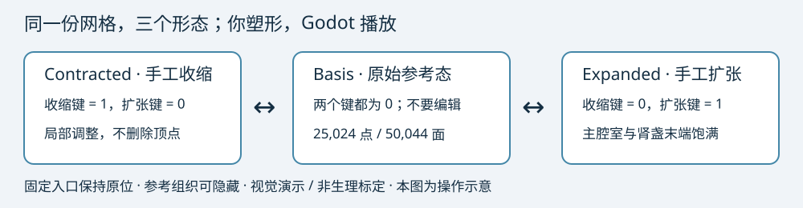

# 肾腔手工塑形：先做出清楚的视觉变化

本轮只准备工作流，最终 Contracted／Expanded 外形由你制作和确认。无需追求 ±30%，无需先完成容量或复杂碰撞计算。模型上屏统一标注“视觉演示／非生理标定”。

## 1. 打开哪份工程

用 **Blender 5.2.2 LTS** 打开仓库中的 `visual_demo/blender/kidney_manual_v1.blend`。

**不要编辑** `kidney_pipeline_DRAFT_TEST_ONLY.blend`：它是通道测试副本，只有约 0.0515 mm 的占位变化。

编辑工程的三个 Shape Keys 起初相同，所以刚打开时切换不会变化。这是预期状态。原始 Reference 来自已验收数组，25,024 点、50,044 面；不需要导入 OBJ。



## 2. 选对对象和形态键

1. 在右上 Outliner 展开 `01_Cavity_EDIT_THIS`，选择 **KidneyCavity**。
2. 右侧 Properties 点绿色三角形 **Object Data Properties**。展开 **Shape Keys**。
3. 点击 **Contracted** 这一行。不要选 Basis。
4. 保持工程已开启的 **Show Only Shape Key／图钉**，使视图只显示当前形态键。按 `Tab` 进入 Edit Mode。
5. 修改的是当前 Contracted 的顶点位置。不要删除点、加细分、Remesh、Decimate、Boolean 或应用改变拓扑的修改器。不要在 Object Mode 缩放／旋转物体。

Basis 没有自动防编辑锁；导出工具会核对，修改后会拒绝导出而不会静默还原。

## 3. 先保护固定入口

Edit Mode 中按 `Alt+A` 取消选择。在右侧 **Vertex Groups** 选择 **FixedPorts**，点 **Select**，然后在视窗按 `H` 隐藏这些顶点。隐藏只是编辑辅助，不会删点，也不会使导出丢面。普通编辑操作会避开隐藏顶点。

FixedPorts 共 3,675 点。**Vertex Group 本身不是锁**；如果之后 `Alt+H` 恢复显示，仍应避免移动。导出工具逐点检测 Contracted／Expanded 相对 Basis 的固定点位移，有移动就输出编号与毫米位移并停止，不覆盖你的修改。

## 4. 制作 Contracted

- **MainCavity**：取消选择，选分组并点 Select，鼠标移到视窗按小键盘 `.` 聚焦。以选中区域中心为支点，做少量局部缩窄，可先 `S` 微缩或 `G` 局部移动；不要整体缩小全部肾腔。
- **Terminals**：分组便于找末端。逐个末端框选或套索选，单独调整饱满程度；**不要选全部末端一起按 S**，那会围绕共同中心搬动各肾盏。
- **Branches**：只调整较宽部分，细通道保持可辨，避免压扁或断开视觉连接。
- **J_01**：主要用于把主腔室和相邻分支的过渡调整自然。J_05、J_09、B_31／B_32 邻近接口尤其少动。

比例编辑：`O` 开关，工程默认 Connected Only 和 Smooth 衰减。变换时滚轮调整影响圈，每次先用小圈。`G` 移动，`S` 局部缩放，右键取消；`Ctrl+Z` 撤销。需要整理聚集三角面时，选局部点，`F3` 搜索 **Smooth Vertices**，少量重复；不是删除顶点。

优先 Edit Mode；Sculpt 的 Grab／Elastic Deform 可作为熟悉后的补充。不要启用 Dyntopo、Voxel Remesh 或改变点数的 Sculpt 功能。不要把末端捏成尖点。

完成后 `Tab` 回 Object Mode，`Ctrl+S` 保存。这个操作保存整个工程和当前形态键，不需要把它导出成另一个 OBJ。

## 5. 制作 Expanded

Object Mode 中点击 **Expanded**，确认当前行，保持图钉，再 `Tab` 进入 Edit Mode。

按顺序调整：MainCavity → 部分 Terminals → J_01 → 必要的 Branches／其他 Junctions。主腔室和末端明显饱满即可，各末端不必等幅。每次小幅操作，多视角观察。不要用全模型统一放大替代局部塑形。

如果邻近肾盏明显相互穿过，直接局部 `G` 或 Smooth 修形。外层组织先静态参考，不要求你解决非线性组织跟随。明显超出组织时，可选择纯腔体展示；不能把透明显示当作组织已协调。

## 6. 视角和参考辅助

| 操作 | 快捷方式 |
|---|---|
| 前／后视图 | 小键盘 1／Ctrl+1（Blender −Y／+Y） |
| 侧视 | 小键盘 3／Ctrl+3 |
| 俯／仰视 | 小键盘 7／Ctrl+7 |
| 旋转／平移／缩放 | 中键拖动／Shift+中键／滚轮 |
| 聚焦主腔室或 J_01 | 选对应组，小键盘 `.` |
| 临时局部视图 | 小键盘 `/` |
| 视窗局部裁剪观察 | Alt+B，框选；再次 Alt+B 取消 |

`03_STATIC_MARKERS_PATHS_NOT_DEFORMED` 是原始静态 Marker 和中心线，显示／隐藏用 Outliner 眼睛。它们不会随手工形变移动，也不导出进 GLB，不用修改 Marker。

组织在 `02_Tissue_STATIC_REFERENCE`，默认隐藏且不可选。用眼睛／`Alt+H` 恢复对应对象显示；需要透明观察时，将视窗着色从 Solid 切为 Material Preview，再调整组织材质 Alpha。Solid 的颜色 Alpha 不保证真实透明；也可用视窗 X-Ray 或直接隐藏组织。纯腔体视图最容易比较轮廓。临时组织显示不参与形态键。

## 7. 检查三态并保存

1. 回 Object Mode，关闭 **Show Only Shape Key／图钉**。
2. 把 Contracted、Expanded 的 Value 都设为 0：Reference。
3. 只把 Contracted 设为 1：收缩态。
4. Contracted 回 0，再把 Expanded 设为 1：扩张态。
5. 分别用 0.5 检查各半程，不要同时把两个终态权重调大。
6. 同一视角比较；重点看 MAIN、J_01/J_05/J_09、B_27/B_30、细分支和全部末端。
7. `Ctrl+Shift+S` 可另存为 `kidney_manual_v2.blend` 保留版本。然后把已保存的文件路径告诉 Codex。

完成后由 Codex 做简易检查和导出。不需要你手动套用复杂求解器或寻找精确容量百分比。

## 8. 导出／Godot 测试命令

仓库根目录 PowerShell：

```powershell
$vdBlender = 'E:/Apps/blender 5.2/blender.exe'
$vdGodot = 'E:/Apps/Godot/Godot_v4.7-stable/Godot_v4.7-stable_win64_console.exe'
& $vdBlender --background visual_demo/blender/kidney_manual_v1.blend --python-exit-code 1 --python visual_demo/tools/export_blender.py
& $vdGodot --headless --path godot_sim --editor --import --quit
& $vdGodot --path godot_sim --rendering-method gl_compatibility res://visual_demo_kidney.tscn
```

现阶段导出名仍为 `kidney_visual_DRAFT.glb`，不代表美术验收。导出会校验 Basis、源点／面索引、固定入口、有限坐标与明显退化／反面；失败详见 `visual_demo/reports/export_validation.json`，不会修改你的 `.blend`。

Godot 编辑器打开 `visual_demo_kidney.tscn` 后按 **F6**，不要按 F5 去启动原主场景。界面支持三态、−1～1 滑块、播放／暂停／重置、静态透明组织、透明度与镜头复位。右键旋转、中键平移、滚轮缩放。20 秒测试循环用同一份 Morph Mesh 连续播放，未启用旧 P2 播放器。

手工工程初始没有形变；现在 Godot 展示的是专用小幅占位测试副本。人工塑形完成并导出后才有你期望的明显变化。本阶段不录像、不改内镜路径。

## 9. 当前检查的含义

检查仅服务于视觉制作。没有发现明显退化或有限采样异常，不等于全程无穿透、医学安全、真实组织协调或生理容量标定。屏幕暂不显示未经审核的 mL 和百分比。旧 D2 Reference 16.805962087430178 mL 保留，但不拿它推算手工终态容量。
