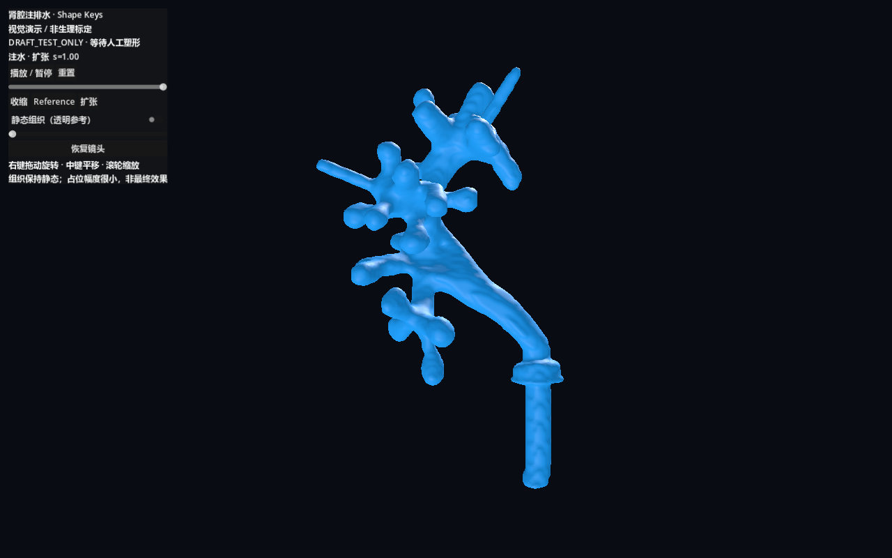
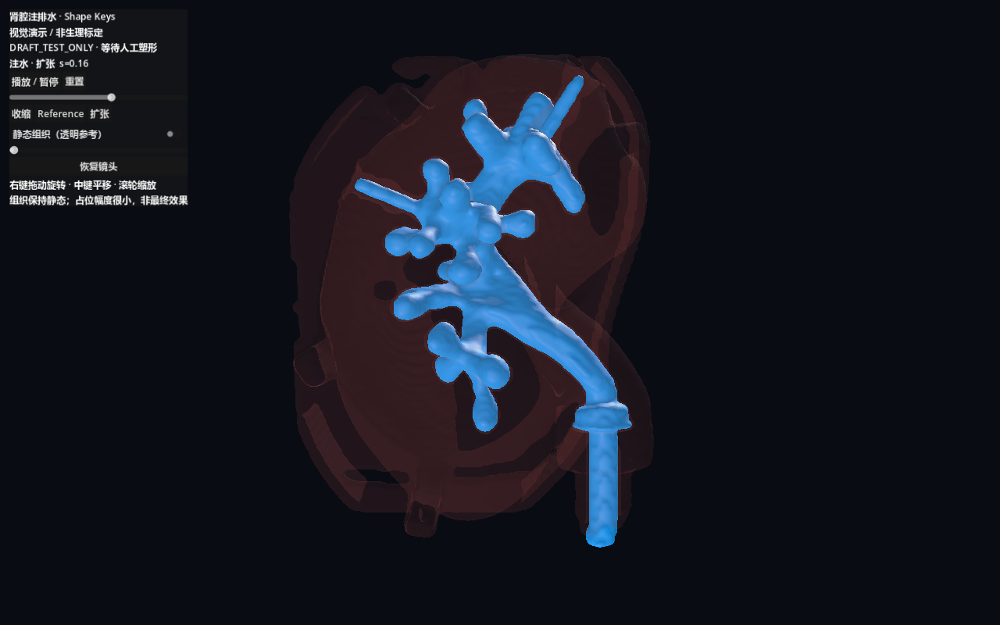

# V-Demo.1：人工塑形工作流准备交付

日期：2026-10-16。**已准备编辑工程和导出播放通道；最终收缩／扩张外形尚未人工制作或验收。**

本轮把重点收敛到手工表面调整。无需在演示前求解 ±30%、全量 CCD、真实压力或组织材料。旧研究原样保留，演示没有更改 D2 或 P1/P2。

## 立即可用

- **手工工程：** `visual_demo/blender/kidney_manual_v1.blend`。Basis、Contracted、Expanded 起初相同；25,024 点、50,044 面、源编号和面顺序经保存后只读复核一致。
- **分组：** Terminals 3,659，MainCavity 2,299，J_01 67，Branches 13,919，OtherJunctions 595，InterfaceTransition 810，FixedPorts 3,675。J_01 不重复。72 个静态 Marker、37 条静态路径独立保留。
- **指南：** `Blender手工塑形指南.md`。从选择形态键、隐藏固定点、比例编辑，到多视角检查、保存、导出和 F6 运行。
- **独立场景：** `godot_sim/visual_demo_kidney.tscn`。用一份导入 Morph Mesh 和两个互斥权重播放 20 秒循环。滑块、三态、暂停、重置、镜头及静态透明组织可用；没有调用原 P2。

专用 `kidney_pipeline_DRAFT_TEST_ONLY.blend`／`kidney_visual_DRAFT.glb` 只用于通道测试，最大占位位移约 **0.05147 mm**，不追求明显视觉变化。你应编辑手工工程，不用调整测试副本。

## 实测与简易检查

Blender **5.2.2 LTS**，构建哈希 d13f752e3b9c；Godot **4.7.stable.official.5b4e0cb0f**。实际读取本机导出算子的 RNA 参数后导出 Morph Targets，没有假设旧 API。源码中记录每份权威输入 SHA，P2 六数组核对通过。

坐标：`Blender=(RAS_mm−[16,16,−81])*0.001`；glTF／Godot 为 `(Bx,Bz,−By)`，米，右手坐标，行列式 +1。Blender 视角名按自身约定；Godot 默认镜头从解剖前侧看，视角不同不是修改模型。Reference GLB 单坐标最大误差约 **1.85e-9 m**。Blender 内部 float32 量化量记录在 export_api.json；源序导出以“原始参考＋Key−Basis增量”保留权威 Reference 精确不变。

GLB 带 `_SOURCE_ID`，所有导出腔体三角面映射回原索引一致。Godot 实测导入 25,024 点／50,044 面、两个正确名称和顺序；五档 `s=−1,−0.5,0,0.5,1` 实际烘焙位置与 GLB 预期对应集合误差为 0，法线有限。不能据此假设以后所有 GLB 顶点都不拆分／重排，校验器使用映射和位置集合。

测试副本三态及五档插值无 NaN／Inf、退化或相对参考反面，固定3,675点无移动。修改 Basis／移动固定点的合成拒绝测试通过；不会静默覆盖人工编辑。最初沿法线直接推拉的占位试验导致薄面片翻折，已被拒绝，记录保存在 `attempt_normal_draft_REJECTED.json`；后改用局部平滑小幅测试场，仅用于导出验证。

**12 项 Python 检查通过。2,708 个历史文件 SHA 无变化。** 保护报告排除 Godot 自动生成的 import／translation 缓存及 Python 缓存；没有修改历史模型、代码或研究证据。新 GLB 禁用 LOD、切线自动生成及顶点压缩，没有为提速删面。

短时图形实测：RTX 4070 Ti，1280×800，每个后端7秒连续循环片段，其中3秒显示透明组织。

| 后端 | 帧率均值 | 帧时间中位数 | P95 |
|---|---:|---:|---:|
| Forward+ | 164.84 FPS | 6.06 ms | 6.25 ms |
| Compatibility | 164.47 FPS | 6.06 ms | 6.06 ms |

这是受当前显示刷新／帧率条件影响的小幅占位测试，不保证最终手工模型或录像性能，也没有“解决旧 P2 18～19 FPS”的含义。最后图形运行日志没有影响播放的错误；初次导入缺 UV 切线错误通过禁用不需要的切线生成消除。原生 Blender UI 截图授权超时；没有伪造编辑器截图。指南图为示意，以下为实际 Godot 视口截图。





## 复现与保护

在仓库根目录：

```powershell
$vdPython = 'E:/Apps/Conda/miniconda3/envs/FURS/python.exe'
$vdBlender = 'E:/Apps/blender 5.2/blender.exe'
$vdGodot = 'E:/Apps/Godot/Godot_v4.7-stable/Godot_v4.7-stable_win64_console.exe'
& $vdPython visual_demo/tools/prepare.py
# 首次新建才运行；现有手工工程存在时，构建器会拒绝覆盖。
& $vdBlender --background --factory-startup --python-exit-code 1 --python visual_demo/tools/build_blender.py
# 已有工程时，只重建测试副本，保留手工文件：
& $vdBlender --background --factory-startup --python-exit-code 1 --python visual_demo/tools/build_blender.py -- --draft-only
& $vdBlender --background visual_demo/blender/kidney_pipeline_DRAFT_TEST_ONLY.blend --python-exit-code 1 --python visual_demo/tools/export_blender.py
& $vdGodot --headless --path godot_sim --editor --import --quit
& $vdGodot --path godot_sim --rendering-method forward_plus --resolution 1280x800 res://visual_demo_kidney.tscn -- --vd-test
& $vdPython visual_demo/tools/validate_pipeline.py
& $vdPython visual_demo/tools/test_demo.py
```

首次构建和已有工程重建是二选一，不要照抄运行到“已存在”报错后误认为工程损坏。导出工具不保存输入 `.blend`。手工另存为新版本时，将对应路径作为 Blender 输入即可。现在不需要你执行重建命令，直接打开已交付工程最方便。

新增文件仅位于 `visual_demo/`、`godot_sim/visual_demo/` 和独立 tscn。`delivery_manifest.json` 保存新增交付哈希；`.blend` 不在 Godot 项目内，不会被自动导入。没有改主场景、内镜、碰撞、既有路径和状态机。

## 停止与人工交接

请你制作 Contracted 和 Expanded，保存后通知 Codex。当前三态不是最终视觉效果，不能声称已完成美术验收。

本轮没有进行全量三角自交／连续碰撞认证，没有求解组织跟随，没有测手工终态 D2 容量，画面不显示容量 mL／比例；这些不阻止先完成手工视觉演示。静态透明组织只作参考，不能掩盖明显穿出并声称组织已协调。

等人工塑形完成，再进行简易复核、导出、独立演示和展示验收。当前不录像、不修改内镜、不推进旧 N2 数值路线。

API 参考：[Blender glTF API](https://docs.blender.org/api/5.0/bpy.ops.export_scene.html)、[Blender glTF 手册](https://docs.blender.org/manual/en/5.1/addons/import_export/scene_gltf2.html)、[Godot 4.7 MeshInstance3D](https://docs.godotengine.org/en/4.7/classes/class_meshinstance3d.html)。本机5.2导出参数由实际 RNA 核验，未将旧文档签名直接照搬。
