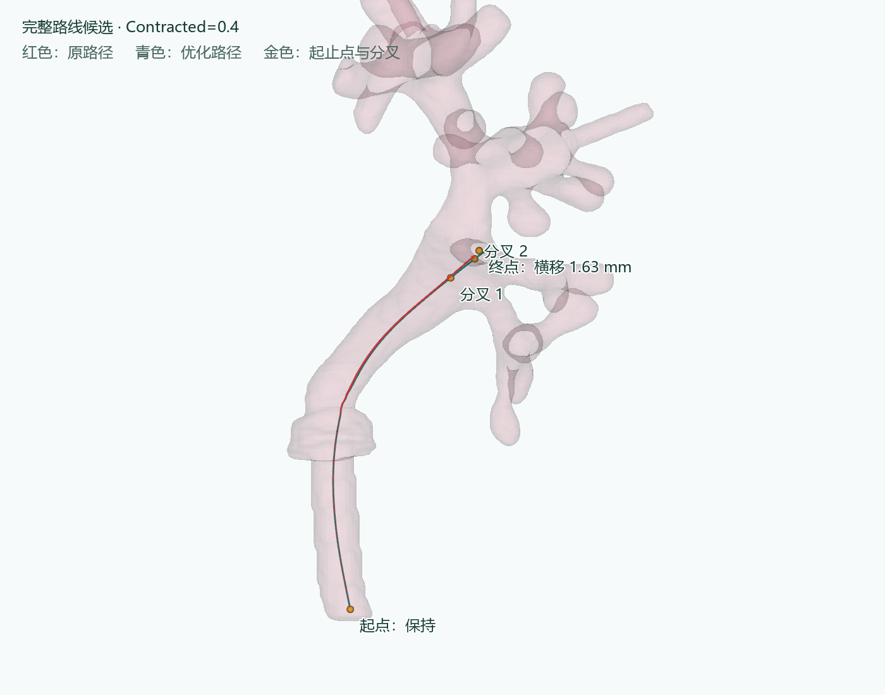
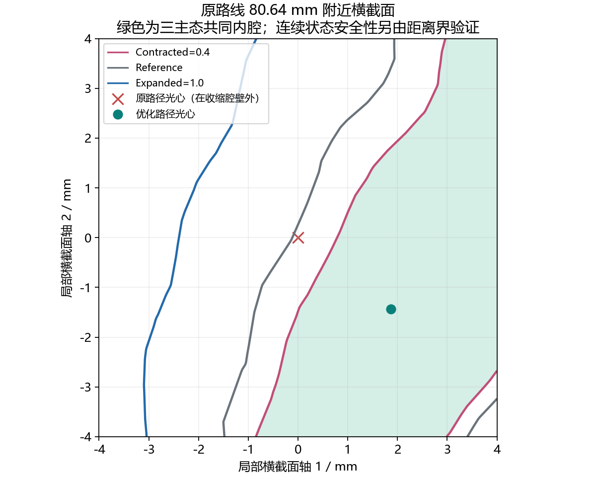
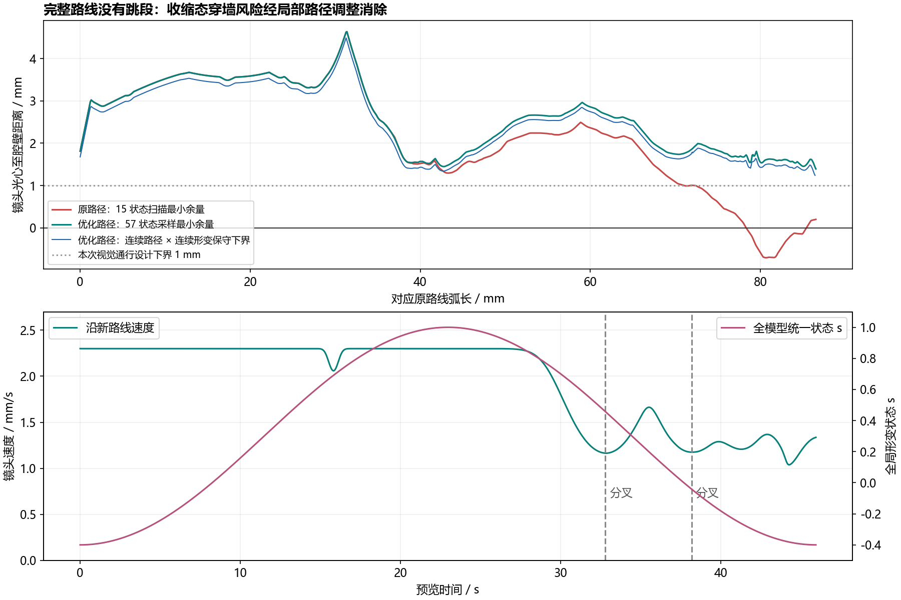
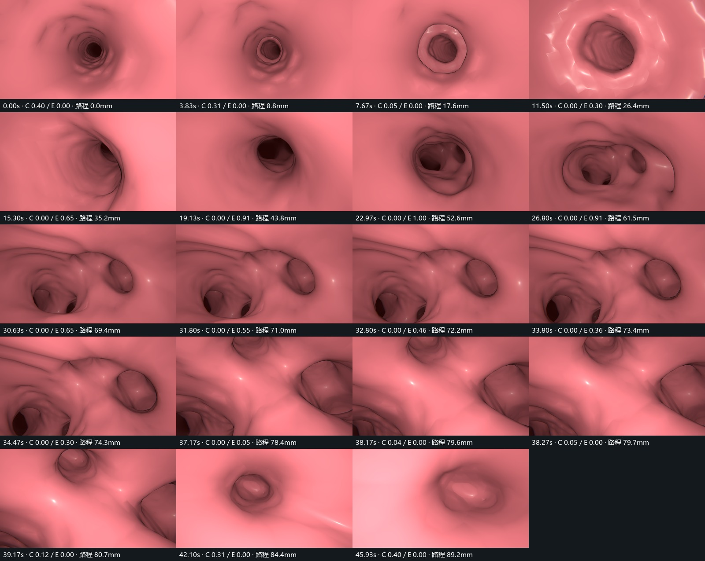

# V-Demo 完整路线可行性报告与候选路径

日期：2026-10-16。状态：**可行性分析及预览已完成，等待用户确认；未录制新的最终 MP4。**

## 结论与需要确认的方案

在现有人工 `kidney_manual_v3.blend` 下，找到了一条贯穿完整路线、对整个 **Contracted(0.4) → Expanded(1.0) → Contracted(0.4)** 范围有效的演示光心路径。**按本次视觉通行标准，暂不需要 v4 局部修形。**

候选方案保留原起点，按原顺序经过两个分叉，连续走到原终端区。为避开原终点附近的薄余量，终点横向移动 **1.633 mm**；沿途相对原路线最大偏移 **2.386 mm**。新路径长度 **89.180 mm**，建议以约 **45.933 秒**完成一个全局同步形变周期。

请确认：是否采用这条完整路线、终点调整及约 46 秒的节奏。确认后再制作完整路线第一人称最终视频；本次不制作外部视频或拼接功能。



## 1. 输入与保护范围

本次沿用当前仓库 V-Demo 交付中的正式人工 v3 GLB 与原路径。未发现独立命名为 V-Demo.5 的文件，以当前已提交的 Godot v3 交付（提交 `32d3584`）作为实现基线。

| 输入 | 核验结果 |
|---|---|
| 人工工程 `visual_demo/blender/kidney_manual_v3.blend` | SHA-256 与上一轮实际 Blender 导出检查一致 |
| 正式 GLB `godot_sim/visual_demo/assets/kidney_manual_v3.glb` | 与人工 v3 导出记录一致；未使用 DRAFT |
| Shape Keys | Basis、Contracted、Expanded；25024 顶点、50044 三角形 |
| 原路线 | `godot_sim/data/organ_2_kidney/lab_6/cavity_path_stone1.json`，88 点，约 86.532889 mm |
| 原模型基础网格 | 闭合、面绕序一致；包含性结果与有符号距离在三主态交叉核对一致 |
| 文件保护 | 2755 个受保护文件前后哈希一致，包含人工工程、正式 GLB、原路径、main.tscn、原控制器、项目设置和原权威数据 |

人工工程 SHA-256：`a450e8f639d7d647ff8238a09cff2f20458beb4f8a4229b72ea6e425e6802d69`。

原路径 SHA-256：`facf00db36ab26632032b5af00e67947f101082eef55ca606c1fd357ee5caea2`。

工作区原有未跟踪文件 `kidney_manual_v3_copy.blend` 未使用、未修改。

## 2. 原完整路线为何不能直接播放

对原路线以约 0.1 mm 间距取样，先扫描 `s=-0.4…1.0` 的 15 个状态。原路径在收缩及部分中间状态出现穿墙，不能用“刚好扩张时通过”来代替全周期可行性。

| 状态 | 原路径最小有符号壁面距离 | 结果 |
|---|---:|---|
| Contracted=0.4 | −0.707 mm | 约 78.34–85.33 mm 区段有路径点在腔壁外 |
| Contracted=0.3 | −0.496 mm | 仍有穿墙 |
| Contracted=0.2 | −0.292 mm | 仍有穿墙 |
| Contracted=0.1 | −0.094 mm | 仍有穿墙 |
| Reference | +0.104 mm | 虽未穿墙，但余量非常小 |
| Expanded=1.0 | +1.425 mm | 光心位于腔内 |

最严重问题位于原弧长约 **80.64 mm**，RAS 位置约 **(22.431, 9.467, −74.725) mm**。原终点在 Contracted=0.4 时只有 **0.199 mm** 壁面余量。



绿色仅表示图中三主态共同内腔。完整连续状态的安全性由下面的距离界分析单独验证，不以这张截面图代替证明。

## 3. 路径优化如何保持完整走向

沿原路线建立最大间隔 0.75 mm 的纵向截面，并将两个原分叉弧长加入截面序列。每个截面在原光心附近 ±3.5 mm 范围内，以 0.5 mm 网格搜索共同内腔中的候选位置。优化同时惩罚低壁面余量、过大横移和相邻截面的突变，随后平滑并重新细分。

最终路径包含 **869 个点**，最大相邻点距离约 **0.198 mm**。每个新点保留对应原弧长，原弧长严格递增，覆盖 **0–86.532889 mm** 全部区段；没有跳段、删去风险区、瞬移或绕去远处管支。原路线中的点数变化只发生在独立演示路径中。

| 项目 | 原路线 | 新演示路线 |
|---|---:|---:|
| 总长度 | 86.533 mm | 89.180 mm |
| 点数 | 88 | 869 |
| 第 1 分叉弧长 | 71.998 mm | 72.218 mm |
| 第 2 分叉弧长 | 78.995 mm | 79.562 mm |
| 起点 | (−10, 22, −139) mm | 完全保留 |
| 终点 | (25.718, 5.096, −73.407) mm | (26.937, 5.510, −72.403) mm |

终点移动 **1.633 mm**，发生在原终点的横截面内，仍处于同一终端区域；没有通过提前结束路线规避后段问题。

## 4. 全路径 × 全动画状态可行性

对优化后的全部 869 点，在 `s ∈ [-0.4,1.0]` 上以 **0.025** 为步长检查 **57 个状态**，共 **49533 个“位置×形态”组合**。所有组合均位于腔内。

| 验证量 | 结果 |
|---|---:|
| Contracted=0.4 的最小采样壁面距离 | 1.391935 mm |
| Reference 的最小采样壁面距离 | 1.521804 mm |
| Expanded=1.0 的最小采样壁面距离 | 1.518990 mm |
| 所有 57 状态的最小采样距离 | 1.391935 mm |
| 连续位置、连续形变的保守下界 | **1.239252 mm** |
| 计入实际 Godot 路径采样误差后的下界 | 约 1.239227 mm |

这比只按预定时间检查一帧对应一个位置更严格：**新路线任一位置在整个允许形变区间都可用**，改变动画节奏也不会让该路线依赖某个特定扩张时机。

未采样中间态按如下方法检查：在每段线性路径与每段线性 Shape Keys 状态区间构成的小区域内，壁面移动距离不超过最大顶点位移乘以状态变化；相机移动距离不超过该路径段长度。因此采用保守界：

```text
区间安全余量 ≥ 四个相邻位置/状态样本中的最小壁面距离
              − 0.5 × 路径段长度
              − 0.5 × 状态间隔 × 对应 Shape Key 最大顶点位移
```

Contracted 和 Expanded 的最大位移分别约 **4.4464 mm**、**6.9290 mm**；状态分段明确包含 Reference=0，不跨越权重映射折点计算同一斜率。所有区间下界均为正，故样本之间不存在未检出的壁面穿越。最小保守余量出现在接近终点、收缩态附近。

这里使用 **1 mm** 作为演示光心连续余量的设计检查线，不将它当作真实内镜半径。未建立碰撞物理，也不声称满足实体器械的直径约束。



## 5. 朝向、分叉和速度信息

新 JSON 重新生成以下内容：

- `points`：完整优化路径，RAS 毫米。
- `forwards`：由新路径弧长前后窗口推导的单位朝向，并进行平滑；不沿用过时的原路径方向。
- `junctions`：两个原分叉在新路线上的弧长映射，顺序不变。
- `speeds`、`speed_mm_s`：无量纲速度倍率及实际速度。
- `arc_lengths_mm`、`times_seconds`：统一时间到弧长的映射。
- `original_arc_offsets_mm`：用于核查完整性和原区段顺序。
- `clearance_certified_mm`：各路径段跨所有形变状态的保守余量。

建议速度约 **1.04–2.30 mm/s**；在弯曲明显处和两个分叉附近平滑减速。两个分叉约在 **32.79 s、38.18 s** 经过。没有为某个局部腔壁另设形变时间。

独立预览控制器复用原控制器的路径采样、最小扭转朝向计算和四元数旋转限速；对新演示路线采用连续跟踪 forwards 的方式，并使用新速度表在分叉处减速。没有调用原自动巡航中“先保持前向、单独周转”的阶段，因此不会在分叉中途冻结前向。此调整仅在新增演示控制器中，原研究控制器文件保持原样。

## 6. 全局同步 Shape Keys 与真实 Godot 验证

整个 KidneyCavity 在同一帧使用同一状态：

```text
u = t / duration
s = 0.3 − 0.7 × cos(2πu)
Contracted = max(−s, 0)
Expanded   = max(s, 0)
```

起点为 `(0.4,0)`，半周期约 22.967 秒为 `(0,1)`，终点为 `(0.4,0)`。Reference 处连续经过，不暂停。部分固定端口本身没有形变，其他部位位移大小也不同，这是人工 Shape Keys 原有空间分布，不是近远处的时间延迟。

Godot 4.7 / Forward+ / RTX 4070 Ti 已真实运行独立预览，保存 **1379 帧**姿态/权重日志与 **19 张**检查截图。没有启用 Movie Maker，没有生成完整路线 MP4。

| 运行检查 | 结果 |
|---|---|
| 路程 | 从 0 连续单调走到 89.179932 mm |
| 首、中、末实际权重 | (0.4,0) → (0,1) → (0.4,0) |
| 相邻帧最大相机旋转 | 约 0.613° |
| 最大前向跟踪误差 | 约 0.056° |
| 运行位置偏离交付路径 | 最大约 0.0000253 mm |
| Godot 导入三态顶点与人工模型偏差 | 均小于 0.00001 mm |
| 三主态中心视线抽样最短前向空间 | 约 5.379 / 6.040 / 8.016 mm |
| 近裁剪 | 0.05 mm；近裁剪平面角点至光心最远约 0.114 mm |
| 近裁剪平面保守壁面余量 | 约 1.126 mm |

前向空间为沿路线约每 1 mm 的三主态射线抽样值，**不将它冒充全连续视野下界**。完整连续光心和近裁剪安全性由上一节独立保证。当前截图未见光心穿墙或近裁剪切壁；局部固定管段仍可看到原网格的多边形高光，属于后续可单独调整的显示效果，不需要为此修改人工 Shape Keys。本次没有对所有材质闪烁作逐像素视频认证。



## 7. 如何查看与运行

所有新增内容都位于 `visual_demo/full_route_v6`、`visual_demo/tools/full_route_*.py` 及 Godot 的独立演示目录，不替换上一版视频。

1. **连续 Godot 第一人称预览**：在现有项目打开 `godot_sim/visual_demo_full_route_preview.tscn`，关闭 Movie Maker，按 F6。默认从完整路线起点前进到终点，用时约 46 秒，到终点保持画面；F8 停止。根节点的 `Duration Seconds` 可调整节奏；`Preview Loop` 默认关闭，避免重播起点造成跳跃。
2. **路径对比与截图查看**：双击本目录 `index.html`，可旋转三维模型，调节全局形变状态，并拖动截图索引。HTML 完全本地使用，不上传数据。Codex 内置浏览器不允许 `file://`，因此未在该浏览器进行交互实测；静态图已查看，核心连续预览已在 Godot 实测。
3. **直接查看路径文件**：`godot_sim/visual_demo/data/full_route_c04.json`。
4. **完整静态检查**：本报告、`preview/route_overview.png`、`preview/contact_sheet.jpg`、`preview/critical_cross_section.png`。

命令行预览（在仓库根目录执行）：

```powershell
& 'E:/Apps/Godot/Godot_v4.7-stable/Godot_v4.7-stable_win64_console.exe' `
  --path godot_sim res://visual_demo_full_route_preview.tscn
```

可重复的 30 FPS 验证预览，不录制视频：

```powershell
& 'E:/Apps/Godot/Godot_v4.7-stable/Godot_v4.7-stable_win64_console.exe' `
  --path godot_sim res://visual_demo_full_route_preview.tscn `
  --fixed-fps 30 --disable-vsync -- --audit --once
```

`--audit` 以固定帧序号控制时间，写出权重、位置、姿态和选定截图。此预览场景会拒绝 Movie Maker 启动；等用户确认后再建立最终录制入口，避免误录旧的短路径或旧的 0.6 动画。

## 8. 可复查证据

- `reports/original_full_route_scan.json`：原路径 15 状态扫描及风险区段。
- `reports/corridor_search.json`：横截面搜索条件、端点变化。
- `reports/feasibility.json`、`data/validation_grid.npz`：57 状态结果与连续界。
- `reports/view_validation.json`：视线抽样、近裁剪界、实际位置及权重验证。
- `reports/godot_preview.log`、`preview/frames.csv`、`preview/runtime.json`：真实 Godot 运行记录。
- `reports/protected_before.json`、`reports/protected_after.json`：源文件零改动校验。
- `preview/imported_*.bin`：Godot 导入三态顶点的 RAS 坐标。

重现脚本顺序为 `full_route_common.py` → `full_route_optimize.py` → `full_route_validate.py` → Godot 验证预览 → `full_route_view_audit.py` → `full_route_report.py`。Python 使用本机 FURS 环境中的 NumPy、SciPy、VTK、Matplotlib、Pillow、Plotly；Godot 正常 F6 预览不依赖这些分析库。
